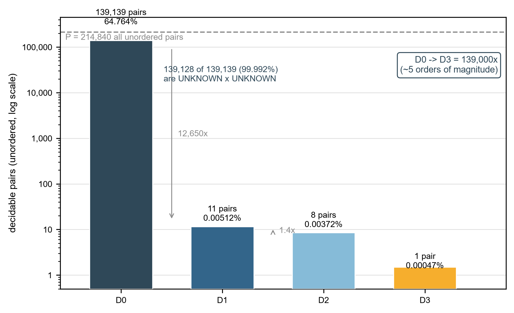
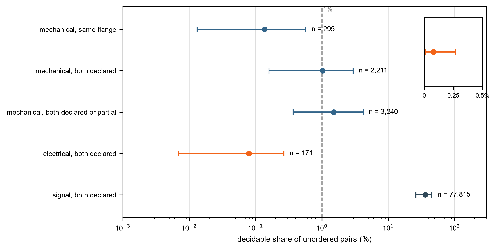
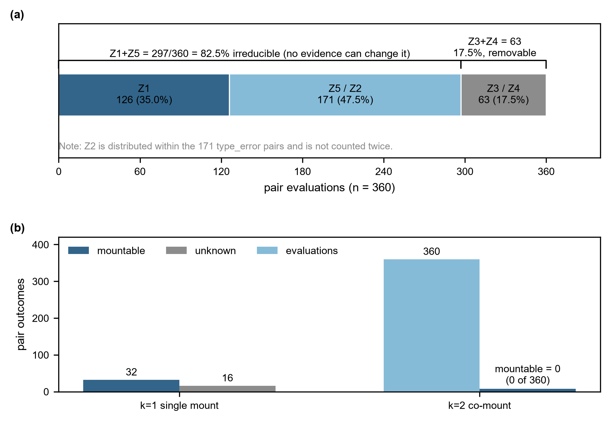

# “兼容”到底有多兼容？机器人末端接口的四级可判定性阶梯与零的分类学

## 摘要

工厂换型时，集成商必须在采购前判断两件末端工装能否螺栓对接、承载同一路电信号，并在同一宿主工具连接器上被独立寻址。把这当作判定问题，隐含假设是只要拿到描述答案即出。本文转而测量：在现行证据强度下，答案中多少可判定、代价几何、又有哪一部分再多证据也无法改变。在一个审计目录（非市场普查）的 656 个可组合末端节点、214,840 个无序对、329 家厂商上，四级嵌套证据门槛把电气轴可判定比例从 64.764%（D0，含占位符）逐级压到 0.00512%（D1，排除占位符）、0.00372%（D2，引擎判定类型/针序/性别）、0.00047%（D3，人工校正连接器所在位），跨度五个数量级。顶端主要是占位符自匹配：553 个电气端口中 528 个带 `ELEC:UNKNOWN`，139,139 个 D0 对中 139,128 对（99.992%）是 unknown 配 unknown。厂商整群 bootstrap（B = 1000，seed = 20261109，329 群）显示，在每一 strata 下电气轴点估计均低于机械轴，但两轴在端点处置信区间存在交叠。3 台宿主、16 个器件共 360 次共装对评价中，297 次（82.5%）返回的“零”无法靠补全缺失数据手册消除；端口预算命题证明：在 UR3e 与 UR5e 这两台只暴露一个独立供电、独立寻址工具侧槽位的宿主上，任何两器件共装问题都不可满足，与双方声明完整度无关。宿主侧结论仅限三台机器人；D3 的单一对是真器件对器件互插的下界而非上界；κ = 0.6236 度量的是关键词规则与人工裁定的一致性，不是两名编码员之间的一致性。本文贡献按序为：四级阶梯与五个数量级落差、分层最弱轴判定、零的分类学 Z1–Z5、端口预算命题 P1 与推论 C1–C3、法兰是套件属性而非器件属性。

**关键词：** 末端工装；机器人末端接口；可判定性阶梯；端口预算；零的分类学；混合机器人单元；接口标准化缺口

---

## 1. 引言

可重构制造单元在集成时刻是一连串采购决策。下单前必须回答四个窄问题：机械法兰是否共享螺栓孔位；电气连接器是否承载相同针脚分配；宿主是否有空闲槽位同时寻址两者；两个器件控制角色是否冲突。在成熟信息生态里这四个问题都可由查询零件描述回答；而在 2026 年工厂实际运行的生态里，每个问题都由一个人下载 PDF、翻手册表格、最后以“大概可以”或“去问厂商”收尾。这一缺口文献界已命名至少十年。Tola 等 [1] 把自动配置障碍归为六类，并指出不存在成熟的公共机器人系统配置器。

这一人工流程导致可重构单元换型缓慢。学界为弥合缺口建了三类东西：硬件信息模型（HRIM 引用最广，把模块间交换的消息标准化，而非把模块实际对接的物理表面标准化）；商业市场目录（UR+ 是此类硬件最大的一个，按品类筛选产品但不暴露接口字段）；配置与约束推理文献（提供三值、部分、占位符推理的形式语汇，但输入上假设约束本身已知）。每一类在自己范围内都做了有用工作，但没有一类回答工厂真正面对的测量问题：在一个固定目录上，按现行手册证据强度，兼容性问题中有多少可判定？残余之中又有多少是结构性的、而非信息缺失造成？

本文完成这一测量转向。固定语料不变，只移动证据门槛，定义四条嵌套判定规则 D0 到 D3，报告 214,840 个无序对中每条规则可判定的比例。四个比例分别是 64.764%、0.00512%、0.00372%、0.00047%。阶梯之间落差为 D0/D1 = 12,650 倍、D1/D2 = 1.4 倍、D0/D3 = 139,000 倍。落差本身就是结果：任何一个不标明门槛的“兼容率”数字，都隐含地选了阶梯上相差五个数量级的某一阶。顶端落差的机制是可识别的：553 个电气端口中 528 个带占位标签 `ELEC:UNKNOWN`，D0 对中 99.992% 是 unknown 配 unknown。

本文贡献按展开顺序列出。第一，四级可判定性阶梯与五个数量级落差，机制是占位端口自匹配。第二，分层陈述的最弱轴判定：机械、电气、信号三轴点估计跨定义差 11 倍，电气轴点估计在每一 strata 下均低于机械轴；同时明确拒绝“电气永远低于机械”这一更强概化，因为两轴在端点处的置信区间存在交叠。第三，零的分类学 Z1–Z5，并对每一类给出“补证据能否消除”的判定：360 次共装评价中 297 次（82.5%）的零无法靠补全缺失数据手册消除。第四，命题 P1（端口预算上界）及推论 C1–C3，按公理化—演绎链写出，证明可逐句检验。第五，法兰是套件属性而非器件属性：同一夹爪经不同耦合套件对应三种法兰标号，因此目录中“机械可判定”的对主要是套件规格同一，而非器件可互换。

定位句：前人把接口兼容性当作判定问题——给出描述即得答案；本文证明它是测量问题——可判定率是证据门槛的函数、跨五个数量级，并给出零的结构上界，再多证据也无法移动它。

## 2. 相关工作与定位

### 2.1 系统配置与接口建模

最贴近的前身是机器人系统配置器文献。Tola 等 [1] 把自动配置障碍归为六类，并指出配置任务只能靠有经验的系统集成员完成；其博士论文 [2] 演示了一个约束式配置器，并指出主流机器人描述格式承载运动学与可视化，而不承载连接器互插。RoboCIM 领域模型论文 [3] 在可废止推理框架内形式化配置器。一项覆盖欧洲机器人生态的访谈研究 [4] 从产业侧印证硬件标准化缺失是产业自己陈述的挑战。Ulrich [5] 把产品架构定义为把产品功能分配到物理组件上的方案；Mehrabi 等 [6] 认为可重构制造系统是生产系统演化的下一步。[5,6] 与配置器路线 [1–4] 共享前提：组件之间的接口层已经可被推理。Chaumet 等 [7] 把综合步骤写明：从模块化组件创建设计需要三步——获取组件知识、构思概念、落实为具体设计；知识工程配置基线 [8] 把知识表示本身作为研究对象。本文要测量的是：当第一步——获取可用组件知识——结构性缺失时会发生什么。

Tampere 能力匹配线是最明确主张“硬件接口描述驱动组合”的前身。Siltala [9] 把目标写成基于形式化描述的硬件接口创建资源组合；Siltala 等 [10] 把接口匹配定义为评价所提资源集能否物理连接。其形式资源模型见 [11]，匹配过程见 [12]，产品模型本体见 [13]，Web 自动化工具见 [14]；Mital 等 [14] 自己也承认此类匹配目前耗时严重、依赖设计师经验。Zheng 等 [15] 在本刊发表的工作研究组件级接口模型如何传播到机电系统配置设计，其传播假设描述层已被填充。这些工作为本文测量提供了动机：缺口既已命名十年，下一个问题就是在一个陈述的证据门槛下缺口有多大。

### 2.2 硬件信息模型

HRIM [16] 是机器人领域引用最广的模块化硬件信息模型。其作者指出“在机器人领域目前不存在一个主导性的即插即用标准”；其公开仓库含 21 个类模型、3 个实例级数据手册、0 个机械互插字段、0 个连接器级电气字段。一个描述话题的模型无法判断两个法兰能否螺栓对接，本文把这视为模型的属性而非作者的缺陷。机械层上，ISO 9409-1 [17] 是机器人法兰接口的事实标准；该标准自己的范围说明指出它旨在保证末端执行器的互换性，且不定义末端耦合装置的其他要求。本文机械轴以 ISO 9409-1 标号为证据单位，第 8 节将显示同一标号可描述器件、耦合套件或宿主侧适配器。

### 2.3 市场目录与信息完备性

UR+ 生态 [18] 是 UR 兼容末端硬件最大的策展市场目录。其落地页邀请集成商探索可信赖 UR 伙伴生态；而在本审计目录中，它列出 528 个产品、四个筛选维度，每个产品暴露 0 个接口字段。OnRobot 快换盘页面 [19] 声明快换盘结合了低重量与可靠的 ISO 9409-1 接口——ISO 接口声明在快换盘上，而不是工具上。一个为商业兼容性策展产品、却仍不暴露机械或电气接口字段的市场目录，已独立收敛到与 HRIM 相同的描述层。Wang 与 Strong [20] 指出数据消费者的改进努力往往窄窄聚焦于准确度，而不完备、表示一致性、可访问性是独立的质量维度；Redman [21] 量化了劣质数据质量对企业的代价。接口字段缺失是不完备缺陷，不是准确度缺陷，仅靠准确度审计看不见它。

### 2.4 部分约束、三值与占位推理

处理配置中缺失信息的形式语汇来自部分约束与三值约束满足。Freuder 与 Wallace [22] 提出部分约束满足，把解视为可满足约束子集的分级概念；Schiex 等 [23] 形式化值约束满足，约束以程度满足而非满足/不满足二值；Dubois 等 [24] 把这一思路扩展到可能性理论。Ciucci 与 Dubois [25] 给出第三真值的代数处理，聚焦于第三真值表示 unknown 的情形；这正是第 4 节 `ELEC:UNKNOWN` × `ELEC:UNKNOWN` 配对的形式对应——它是第三真值的自碰撞，不是缺失数据点。Mittal 与 Falkenhainer [26] 引入动态约束满足，指出与解相关的变量集合在问题求解过程中动态变化；活动约束是只有端口被声明后才相关的器件的形式模型。Brewka 等 [27] 综述回答集编程作为 RoboCIM 路线 [3] 已经原型化的默认推理工具。这些路线给了本文“unknown”作为一阶判定语汇，而不是失败计算。但它们都假设底层约束集已被填充，把“一个真实厂商目录中究竟填充了多少约束”留给经验工作。

### 2.5 定位与差异

2024 年配置研讨会论文集 [28] 重新审视研究前沿，14 篇入选论文覆盖 LLM 辅助、绿色与学习式配置；论文集中没有一篇审计市场目录的接口字段完备性。由此引出三点具体缺口：没有前身工作在固定审计目录上、按陈述的证据门槛测量可判定比例；没有前身工作把残余零分为“补数据手册可消除”与“不可消除”两类；没有前身工作给出与声明完整度无关的共装结构上界。本文余下部分依次回答这三点。

## 3. 语料、隔离与溯源

### 3.1 目录

起点是机器人末端硬件公开厂商列表的一次审计快照。它共含 868 个实体，其中 656 个带 composable 标记进入对集合。对集合是可组合节点的无序对集合，C(656, 2) = 214,840。656 个节点中 329 个带非空厂商字符串（对同一批文件做严格字符串去重得 328 个不同非空厂商字符串；差一家来自原始聚合规则的一家厂商归一化差异，冻结值 329 全文保留；见 9.3 节）。329 个厂商群是第 5 节整群重采样单位。目录是审计目录，不是市场普查；它包含产品、参考设计、通用占位记录与规格节点，排除纯软件条目与重复记录。本文报告的每一个密度都是 214,840 个可组合节点无序对之上的密度，不是市场随机样本之上的密度。656 节点覆盖四类器件：执行器与夹爪、力/扭矩与过程传感器、视觉与感知包、宿主侧接口盒。厂商分布长尾，这正是第 5 节整群重采样而非逐节点重采样的原因。

### 3.2 通用占位符的隔离

656 节点中有 22 个是不带真实产品身份的通用占位记录。它们在主密度计算前被隔离到独立桶，剩 634 节点、C(634, 2) = 200,661 个无序对。隔离后对集合是第 9 节第二个密度的分母。

### 3.3 端口清单

可组合节点在三个轴上声明端口：机械（`MECH:`）、电气（`ELEC:`）、信号（`SIG:`）。本文把阶梯聚焦于电气轴——声明覆盖最差的一轴。电气轴清单：553 个电气端口、17 个在用不同类型标签、553 个中 528 个（95.48%）带占位标签 `ELEC:UNKNOWN`、25 个已声明、528 个未声明、6 个节点带多于一个已声明电气端口。25 个已声明端口分布在 19 个已声明节点上，即 4.5 节人工连接器所在位审计所审查的节点。信号轴填充最密：77,815 对共享已声明信号，这就是第 5 节信号轴点估计为 36.220% 的原因。机械轴居中：2,211 对共享已声明机械标号，纳入部分声明后升到 3,240 对。

### 3.4 溯源与源等级

本文每个数字在源头上都打了三级标签之一。**[V]** 表示对照厂商数据手册、手册或官方页面一手核验，并在引用处逐字引用；**[O]** 表示官方或二手口径但未逐字复核；**[E]** 表示本研究在 shipped 语料上现算、可由 shipped 脚本复算。表 1–表 6 均带 Source 列，逐行标 V/O/E。数字本身由早前一组脚本在本地语料上跑出，本文不声称重跑了原始引擎。研究数据包随附三个独立复算脚本，它们从 shipped 文件复现 D0/D1 计数、上界算术与五个 bootstrap 点估计中的四个。两处已知缺口如实保留：D2 引擎判定（8 对）与 D3 人工所在位校正（1 对）无法从 shipped 文件重新推导，按裁定记录逐字带入；机械同法兰 bootstrap 行（295 对）在引擎之上还叠加了一个未在任何 shipped 产品文件中文档化的品类过滤器，9.3 节如实写出并报告未过滤独立重构为 996 对。

### 3.5 检索日志指引

PRISMA 式检索串、筛选日期、纳入与排除理由见随附检索日志与数据溯源文档。本节只报告筛选后语料。

**表 1. 语料与端口计数（源等级 V = 一手核验，O = 官方/二手，E = 本研究现算）。**

| 指标 | 数值 | 单位 | 分母 | 源 |
|---|---|---|---|---|
| 实体总数 | 868 | 实体 | 全目录 | E |
| 可组合节点 | 656 | 节点 | 全目录 | E |
| 无序对 | 214,840 | 对 | 656 节点 | E |
| 带厂商字段的厂商数 | 329 | 厂商 | 656 节点 | O |
| 隔离 22 占位符后节点 | 634 | 节点 | 656 节点 | E |
| 隔离后无序对 | 200,661 | 对 | 634 节点 | E |
| 电气端口总数 | 553 | 端口 | 656 节点 | E |
| 不同电气类型 id 数 | 17 | 类型 id | 553 端口 | E |
| `ELEC:UNKNOWN` 端口 | 528 | 端口 | 553 端口 | E |
| UNKNOWN 占比 | 95.48% | 百分比 | 553 端口 | E |
| 已声明电气端口 | 25 | 端口 | 553 端口 | E |
| 未声明电气端口 | 528 | 端口 | 553 端口 | E |
| 带多于一个已声明电气端口的节点 | 6 | 节点 | 19 已声明节点 | E |
| B1 审计过电气声明的节点 | 19 | 节点 | 656 节点 | V |

## 4. 四级可判定性阶梯

### 4.1 四条门槛的操作化定义

设语料为 656 个可组合节点，分母为 214,840 个无序对。定义四条嵌套判定规则。**D0（共享标签，含占位符）。** 当两端在相关轴上带相同端口类型标签时判为 D0 可判定，其中占位标签 `ELEC:UNKNOWN` 也算一个标签。**D1（共享非占位标号）。** 当两端在排除 `ELEC:UNKNOWN` 后带相同端口标号时判为 D1 可判定，是 D0 去掉占位符后的子集。**D2（引擎判定）。** 当共装引擎对该对的已声明类型、针序、性别返回正判定时判为 D2 可判定，比 D1 严，要求共享 token 在针序与性别上兼容。**D3（连接器所在位校正）。** 当人工审计连接器所在位（器件、适配器、宿主或线缆）确认两端是器件对器件真互插时判为 D3 可判定，是最强规则、D2 的真子集。四条规则构造上层层嵌套：D3 内含于 D2，D2 内含于 D1，D1 内含于 D0。嵌套是有意的：分母保持不变而只移动证据门槛，阶间落差隔离出门槛的效应。一个 D1 不通过的对，D0 之所以数它可判定，只是因为两端都带占位标签；D1 相对 D0 的差集就是那批“靠占位符自匹配才被 D0 判可”的对。

### 4.2 测量结果

把四条规则施于 214,840 对分母：D0 = 139,139 对（64.764%）；D1 = 11 对（0.00512%）；D2 = 8 对（0.00372%）；D3 = 1 对（0.00047%）。落差为 D0/D1 = 12,650 倍、D1/D2 = 1.4 倍、D0/D3 = 139,000 倍。阶梯见表 2 与图 1。

**表 2. 四级可判定性阶梯（214,840 对电气轴全集）。**

| 层级 | 判据 | 对数 | 百分比 | 阶间比 | 源 |
|---|---|---|---|---|---|
| D0 | 两端端口类型标签相同（含占位符） | 139,139 | 64.764% | D0/D1 = 12,650x | E |
| D1 | 排除 `ELEC:UNKNOWN` 后两端端口标号相同 | 11 | 0.00512% | D1/D2 = 1.4x | E |
| D2 | 引擎对类型+针序+性别给出配对判定 | 8 | 0.00372% | D0/D3 = 139,000x | V |
| D3 | 人工连接器所在位校正到器件对器件真互插 | 1 | 0.00047% | — | V |

*图 1. 四级可判定性阶梯（对数纵轴）。柱高报告对数与对 214,840 对分母的百分比；阶间落差标注为 12,650x（D0/D1）、1.4x（D1/D2）、139,000x（D0/D3）。虚线为分母参考线。标注 139,128/139,139 = 99.992% 记录 D0 中 unknown 配 unknown 的份额。*

### 4.3 机制：占位符自匹配

D0 到 D1 的落差是 12,650 倍。它不是两端已声明端口之间的深度物理不兼容造成的，而是两端未声明端口之间的字符串匹配造成的。139,139 个 D0 对中，139,128 对（99.992%）是两端都带占位标签 `ELEC:UNKNOWN` 的对。因此阶梯顶端是一个占位符在配它自己，而不是两件零件可接线的证据。任何不排除占位符就数字符串匹配端口的流程都会报出 D0 风格数字，而该数字会被自匹配 unknown 主导。64.764% 这个头条并不假；它只是回答了一个流程没问的问题。本文余下部分把 D1 当作最弱可辩护阶，把 D2、D3 用于更严的主张。

### 4.4 幸存的 11 对到底是什么

11 个 D1 对坍缩到 8 个引擎 token 上。表 3 列出。读者应看“机制”列而非“对”列：11 对不是 11 个独立器件对器件互插机会。其中三对是同一 Robotiq 2F-85 产品的重复实体共享一个耦合零件；再三对是线缆端 token（M8 5 针传感器线缆与 M12 A-coded IEC 61076-2-101 插座端接在接口盒，而非另一器件）；一对是 UR 工具连接器本身，两个器件争抢它而非互插其上。唯一挺过 4.5 节连接器所在位校正、到达 D3 的，是 DYNAMIXEL TTL 菊花链上的 JST EHR-03 对。

**表 3. 11 个 D1 对，附共享 token 与各对的机制解释。**

| 对 | 共享 token | 机制注记 | 源 |
|---|---|---|---|
| ACT-001 x ACT-002 | JST-EHR-03 | 两端均为器件侧 TTL 端口；DYNAMIXEL 菊花链；唯一挺过所在位校正的对（D3） | V |
| ACT-028 x GRIP-002 | Robotiq COUPLING-10-SPRING-PIN | 适配器位；ACT-028 与 GRIP-002 是同一 Robotiq 2F-85 产品的重复实体 | V |
| ACT-028 x GRIP-006 | Robotiq COUPLING-10-SPRING-PIN | 适配器位；每个夹爪配自己的耦合，两夹爪彼此不能互插 | V |
| GRIP-002 x GRIP-006 | Robotiq COUPLING-10-SPRING-PIN | 适配器位；同一 2F-85 / Hand-E 耦合族的重复实体对 | V |
| ACT-028 x GRIP-002 | Robotiq DEVICE-CABLE-5-POLE-M8 | 同一三节点簇的第二共享 token；是对-token 关联而非新节点对 | E |
| ACT-028 x GRIP-006 | Robotiq DEVICE-CABLE-5-POLE-M8 | 同一三节点簇的第二共享 token；是对-token 关联而非新节点对 | E |
| GRIP-002 x GRIP-006 | Robotiq DEVICE-CABLE-5-POLE-M8 | 同一三节点簇的第二共享 token；是对-token 关联而非新节点对 | E |
| GRIP-012 x GRIP-014 | UR-TOOL-CONNECTOR-COMPOSITE | 宿主位；两器件争抢同一机器人工具连接器，彼此不互插 | V |
| SENS-047 x SENS-37 | 12-PIN-ROUND-AMPHENOL | 线缆位；12 针圆形 Amphenol 辫子端接在接口盒，而非另一器件 | V |
| SENS-049 x SENS-854 | M8-5-PIN-SENSOR-CABLE | 线缆位；目录声明 5 针，但 HEX-E 手册随附 4 针 M8 线缆（B1 校正） | V |
| SENS-031 x SENS-855 | M12-5-PIN-A-CODED-IEC-61076-2-101 | 线缆位；传感器侧 Robotiq FT300 族 M12 A-coded 插座 | V |

### 4.5 从 8 到 1：连接器所在位审计

D2 到 D3 的比值落差较小（1.4 倍），但性质上更关键。它来自对 19 个已声明电气节点的人工连接器所在位审计。审计把每个已声明连接器归到四个位之一：器件侧、适配器侧、宿主侧、线缆侧。19 个节点分解为 4 个器件侧、3 个适配器侧（其中一个同时是宿主侧）、3 个宿主侧、7 个线缆侧。发现是：审计集中没有任何一个末端执行器或传感器拥有真正的器件侧端口；器件侧节点是四个小型执行器包（两个 JST EHR-03 TTL 舵机、一个 EHR-04 执行器、一个 A1257WR-S-3P 带 XT30PW-M 电源连接器），审计中每个夹爪、力/扭矩传感器或相机都把连接器放在适配器端、宿主端或线缆端。所在位校正后，恰好剩下一对是器件对器件真互插：DYNAMIXEL 菊花链上的两个 JST EHR-03 TTL 舵机。这就是 D3 被报告为真器件对器件互插的下界而非估计的原因：19 节点审计是已声明子集，528 个占位端口不在其中，器件侧端口的完整普查只会抬高计数。审计还纠正了两处字符串级 D2 引擎抓不到的手册错误：OnRobot HEX-E 线缆是 4 针 M8 而非数据库记录的 5 针 M8；ATI Axia80 的 8 针连接器在传感器本体上，而 8 针 M12 在线缆端。

### 4.6 解读

阶梯四阶不是对同一问题的四个不同答案，而是四个不同问题。不指名阶、轴与分母就报一个“兼容率”，等于隐含地选了一个阶间差五个数量级的阶梯上的某一阶。本文余下部分把阶固定在 D2 做跨轴比较（第 5 节），把共装引擎返回的零分类（第 6 节），并给出一个在每一阶都成立的结构上界（第 7 节）。

## 5. 跨轴比较与最弱轴

### 5.1 三轴五定义

第 4 节的电气阶梯只是一轴。为识别最弱轴，我们在三轴（机械、电气、信号）上、五条嵌套定义上重复密度测量。五条定义按强度递增为：机械同法兰（n = 295 对，点估计 0.1373%）、机械两端已声明（n = 2,211 对，1.0291%）、机械两端已声明或部分（n = 3,240 对，1.5081%）、电气两端已声明（n = 171 对，0.0796%）、信号两端已声明（n = 77,815 对，36.220%）。信号轴按数量级最密，电气轴最疏。机械轴不是一个数，而是跨自身定义差 11 倍的区间——这是机械轴上的“阶梯”：固定轴、移动证据门槛，机械答案也动一个数量级；固定门槛、移动轴，又动一个数量级。

### 5.2 整群 bootstrap

由于许多厂商在目录中只贡献一个产品，逐对二项区间会低估不确定性。我们改为整厂商重采样：B = 1000 次 bootstrap，seed = 20261109，329 个厂商群整群有放回重采样。95% 区间见表 4 与图 2。区间很宽，宽度就是 329 群下的诚实不确定性；我们如实报告而非收窄。独立重实现复现全部五个点估计与 CI 带，相对偏差约 6%。整群重采样在这里是对的单位，因为目录的对级相关结构由厂商决定：同一厂商的两个零件按同一套手册惯例描述，集成商对某厂商描述质量的不确定性是群级量。

**表 4. 五个跨轴定义的点估计与 95% 厂商整群 bootstrap 区间（B = 1000，seed = 20261109，329 群）。**

| 轴 | 对数 | 点估计 | 95% CI 低 | 95% CI 高 | 跨厂商占比 | 源 |
|---|---|---|---|---|---|---|
| 机械同法兰 | 295 | 0.1373% | 0.0132% | 0.573% | 76.61% | E |
| 机械两端已声明 | 2,211 | 1.0291% | 0.160% | 2.959% | 86.88% | E |
| 机械两端已声明或部分 | 3,240 | 1.5081% | 0.368% | 4.205% | 90.37% | E |
| 电气两端已声明 | 171 | 0.0796% | 0.0069% | 0.268% | 85.96% | E |
| 信号两端已声明 | 77,815 | 36.220% | 26.18% | 45.57% | 97.3% | E |

*图 2. 五个跨轴定义的森林图。点估计与 95% 厂商整群 bootstrap 区间（B = 1000，seed = 20261109，329 群），对数横轴。电气行高亮并内嵌 0–0.5% 放大；虚线为 1% 参考线。*

### 5.3 分层最弱轴判定

机械轴点估计跨定义差 11 倍（0.1373% 到 1.5081%），每一条机械 95% CI 的上界都不超过 4.205%。电气轴点估计 0.0796%，其 95% CI 上界 0.268%。按点估计，电气轴比机械轴低 17 到 230 倍。分层陈述的判定是：在五条定义的每一条下，电气轴点估计均低于同一 strata 下的机械轴点估计。我们明确拒绝更强的一句话概化“电气轴永远低于机械轴”。机械同法兰点估计的 95% CI 从 0.0132% 到 0.573%；电气轴 CI 从 0.0069% 到 0.268%。两区间交叠。可辩护的陈述是分层的：点估计上电气比机械低 17–230 倍；且在每一 strata 下电气点估计都更低。区间交叠如实报告，不隐藏。

### 5.4 去重灵敏度

656 节点全集来自含近似重复厂商记录的源列表。为测试灵敏度，对节点名归一化后重算对集合：645 节点、C(645, 2) = 207,690 对。机械同法兰计数从 295 移到 294 对；D2 计数不变，仍为 8 对。量级偏移低于 4%，轴间定性排序不变。主结果保留 656/214,840 分母，灵敏度在此报告。

### 5.5 轴排序对数据采集预算的含义

轴排序有直接的预算含义。单位证据密度最低的轴是工厂应首先仪表化的轴，因为该轴每多一个已声明端口都以最高边际率把 unknown 对转为已判对。信号轴 36.220% 已填充；机械轴部分填充；电气轴 0.0796% 是下一份文档努力回报最高之处。9.1 节量化这一回报，并显示即便最乐观地补全 35 个真实 A 类件，也无法把电气轴推过 1%。因此预算含义不是“把电气轴文档补全问题就消失”，而是“电气轴是瓶颈，但即便清掉瓶颈也无法在 p = 1 宿主上让共装可判定”。

## 6. 零的分类学

### 6.1 分类对象

共装引擎评价“器件 A 与 B 能否一起装在宿主 h 上”这一问题，宿主与器件集合固定。评价矩阵为 3 宿主 × 16 器件 = 360 次对评价。360 次中，k = 2（一台宿主上两个器件）返回 0 个可装对。判定分解为 171 次类型错误、126 次端口耗尽、63 次 unknown。阶段阻塞直方图为 240 次端口预算耗尽、171 次信号不互补、120 次端口预算 unknown。3 台宿主为 UR3e、UR5e 与 Franka FR3；16 个器件是 9.2 节分诊认定为真实产品而非占位符的法兰承载 EOAT。

### 6.2 Z1 到 Z5

**Z1，端口耗尽（126 对）。** 宿主连接器预算 p(h) 小于两器件合计所需槽位。这是设计约束，不是证据缺口：补数据手册不能让 p(h) 变大。

**Z2，type_error 内部的类型不匹配（分布在 171 个 type_error 对内部）。** 两器件呈现不同法兰或接口类型。该零部分可消除——经适配器，但有可量化代价：8.3 节以 UR20/UR30 适配器为例，它只转换机械、把载荷上限压到 20 kg。

**Z3，器件侧未声明（63 个 unknown 对，背后是 528 个 unknown 端口）。** 器件本身不带接口声明（`ELEC:UNKNOWN`）。该零可直接经后续寻源消除；它是 9.1 节 35 件补全场景的真正目标。

**Z4，宿主侧未声明（63 个 unknown 对的子集，FR3 路线）。** 宿主保持 p(h) 未声明。该零一份数据手册即可消除：Franka 宿主工具侧字段在目录中刻意留空（7.4 节），一份官方页面即可解。

**Z5，角色不互补（171 对）。** 两器件功能冗余：两个夹爪、或两个同型力/扭矩传感器装在同一宿主上。这是需求侧约束，不是证据缺口，补手册不能消除。

**表 5. 零的分类学 Z1–Z5，附计数与“补证据可消除性”。**

| 类别 | 定义 | 计数 | 证据可消除？ | 证据 | 源 |
|---|---|---|---|---|---|
| Z1 端口耗尽 | 宿主连接器预算 p(h) 小于器件所需槽位 | 126 | 否——设计约束（命题 P1） | 共装直方图 port_exhausted = 126；阶段阻塞 port_budget_exhausted = 240 | E |
| Z2 type_error 内类型不匹配 | 两器件法兰/接口类型不同 | 分布在 171 个 type_error 对内 | 部分——经适配器，有可量化代价（如 UR20/30 适配器压载荷至 20 kg） | 共装直方图 type_error = 171 | E |
| Z3 器件侧未声明 | 器件本身不带接口声明（`ELEC:UNKNOWN`） | 63 unknown 对，背后 528 unknown 端口 | 是——后续寻源直接目标 | 共装直方图 unknown = 63；morphology gap_hubs.ELEC:UNKNOWN = 528 | E |
| Z4 宿主侧未声明 | 宿主保持 p(h) 未声明 | 63 unknown 对的子集（FR3 路线） | 是——一份数据手册即解 | robot_tool_side.json FR3 tool_io_ports = null（刻意留空） | V |
| Z5 角色不互补 | 两器件功能冗余（两夹爪、两同型力传感器） | 171 | 否——需求侧约束，非证据缺口 | 阶段阻塞 signal_complementary_not_complementary = 171 | E |

### 6.3 可消除性：82.5% 的算术

可消除类为 Z3 与 Z4。不可消除类为 Z1（设计）与 Z5（需求）；Z2 经适配器部分可消除。不可约份额为 Z1 + Z5 = 126 + 171 = 297 / 360 次共装评价，即 82.5%。主张边界重要：82.5% 是“在 3 宿主、16 器件评价矩阵上、`co_mount_engine/v1` 下，无法靠补器件侧声明消除的共装零”的份额；不是市场上所有可能兼容失败的份额。在该边界内，算术是精确的。

*图 3. 零的分类学。(a) 360 次共装评价堆叠为 Z1（126）、Z2/Z5（171，Z2 分布在 type_error 内不重复计数）、Z3/Z4（63）；花括号标注 Z1+Z5 = 297/360 = 82.5% 不可约。(b) k = 1 单装（32 可装、16 unknown）对 k = 2 共装（360 次评价、0 可装）。*

### 6.4 分类为何超出本语料仍有意义

分类告诉集成商下一小时该花在哪。补一个缺失器件侧声明（Z3）或一个缺失宿主侧预算字段（Z4）把 unknown 判定转为兼容或不兼容；它移动 63 个 unknown 对，但碰不到 126 个 Z1 对或 171 个 Z5 对。反过来，被告诉“补全数据手册就能解决零”的集成商，买到的是一个构造上碰不到 82.5% 零的流程。分类学是把这两种支出分开的诊断。它也把集成商的问题与厂商的问题分开：厂商发两个夹爪本就没有义务让它们共装，Z5 判定记录这一事实而不归咎任一器件的文档。

### 6.5 单装情形：零是共装零

读者可能反驳：目录显然支持一次装一个器件。单装数字证实这一点：k = 1 时引擎返回 32 可装、16 unknown。第 6 节的零特指共装零，不是安装零。32 个可装单器件与 0 个可装共装对并不矛盾；它们是同一硬件在 k = 1 与 k = 2 下的观测。第 7 节命题 P1 解释为什么从 k = 1 到 k = 2 在本研究宿主上不可满足。

## 7. 端口预算：共装的上界

### 7.1 定义

- **宿主** h：工具侧暴露连接器槽位的机器人。
- **槽位**：宿主工具侧一个可被一个器件线缆占用的物理连接器位置。
- **独立供电**：槽位能为占用者供电而不取电于其他槽位。
- **独立寻址**：占用者能在一个与其他被占槽位不同的总线地址上被指令。
- p(h)：宿主 h 上既独立供电又独立寻址的槽位数。
- **器件** d：除非外部供电或总线共享，否则在宿主 h 上占一个槽位。
- **总线共享**：多器件共享一个槽位的电气通道，各取不同总线地址；m 为该总线最大站数。
- k：宿主 h 上共装的器件数。

### 7.2 假设

- **A1.** 一个物理连接器槽位承载一个物理通道。两个器件不能同时占同一槽位。
- **A2.** 每个非外部供电器件 d 从其占用槽位取独立电。
- **A3.** 每个非总线共享器件 d 在其占用槽位上需要独立总线地址。

### 7.3 命题 P1 与证明

**命题 P1.** 若宿主 h 在其工具侧暴露 p(h) 个独立供电、独立寻址的连接器槽位，且器件 d 除非外部供电或总线共享否则占一个槽位，则共装器件数 k 满足 k ≤ p(h)。允许总线共享时，k ≤ p(h) × m。

**证明。**

1. 由 A1，每个非总线共享的共装器件占宿主 h 上一个不同物理槽位。
2. 由 A2，每个此类器件从其占用槽位取独立电；一个槽位不能同时给第二个器件供电而不共享，而 A1 排除共享。
3. 由 A3，每个此类器件在其占用槽位上需要独立总线地址；同一槽位上的两个器件不能各持独立地址。
4. 可被独立占用的槽位数按定义恰为 p(h)。
5. 故非总线共享器件数至多为 p(h)，即 k ≤ p(h)。
6. 若允许总线共享，每个槽位最多容纳 m 站、各占不同地址；上界变为 k ≤ p(h) × m。
7. 该界是上界：等号成立需要每个槽位都被占、每站都可寻址、每个器件都满足供电与寻址条件；任一违反都会降低可达成的 k。

证毕。

### 7.4 推论

**C1.** UR3e 与 UR5e 宿主各暴露一个工具侧槽位（M8 8 针，8 针，1 通道，p = 1）。故 p(UR3e) = p(UR5e) = 1，任何 k ≥ 2 的共装问题在这两台宿主上不可满足，与双方声明完整度无关。第 6 节的 0 个可装对不是文档失败，是硬件。

**C2.** 补全 Z3 与 Z4 只能把一对从 unknown 转为兼容或不兼容；它不能把 Z1 对从阻塞转为兼容，因为 Z1 是对 k ≤ p(h) 的违反，任何额外声明都不改变 p(h)。

**C3.** FR3 宿主在目录中刻意保持 p(h) 未声明（`tool_io_ports: null`；手册描述末端执行器连接器为 2x DI 与 2x DO，24 V 隔离，EN 61131-2 type 3）。其 unknown 对属 Z4 而非 Z1，在 p(FR3) 被声明前不得并入第 6 节不可约计数。

### 7.5 针位与比特的纪律

UR3e 与 UR5e 工具连接器是 M8 8 针连接器。数字 8 是针数，不是通道数；通道数是 1。把针数当比特数会让引擎在一台按 A1–A3 只能服务一个的宿主上报出八个可同时装的工具。该纪律一般化：本文 p(h) 数槽位不数针位；工具连接器带 8 针但 1 通道的宿主，p(h) = 1。Franka FR3 手册列 2x DI 与 2x DO，是四个信号通道而非四个电源槽位；同一纪律把 p(FR3) 保持为未声明，而非 4。

### 7.6 对领域的后果

UR3e/UR5e 上共装兼容文档不只是不完整；它在回答硬件承载不了的问题。一个厂商在同一台 UR5e 工具法兰上给自己两个夹爪发“兼容”声明，除非显式调用总线共享，否则描述的是 P1 禁止的配置。实践建议是目录应把 p(h) 与 m 作为一等字段暴露，让共装查询在更深匹配之前先施 P1。

## 8. 法兰是套件属性

### 8.1 八个厂商案例

本节走查八个厂商案例。其中四个是 [V] 级逐字原文，逐字取自厂商手册、数据手册或官方产品页：案例 1（UR20/UR30 工具法兰适配器）、案例 4（ATI Axia80 传感器连接器）、案例 5（OnRobot HEX-E 随附清单）、案例 7（Franka FR3 末端执行器连接器）。其余四个为 [O] 级：是本审计从目录字段与厂商产品页表述归纳出的结论，非逐字引文，写成陈述句而非引语。

**案例 1，Universal Robots UR20/UR30 工具法兰适配器 [V，逐字，UR 官方适配器页]。** 官方原文为：“UR20/30 Tool Flange Adapter - Official tool flange adapter to convert the UR20/UR30 layout to EN ISO 9409-1-50-4-M6 (e-Series layout). Maximum rated payload 20 kg.” 该原文显示跨代兼容仅靠适配器实现，适配器把机械转换到 e-Series ISO 9409-1-50-4-M6 布局，转换伴随 20 kg 的量化载荷代价；它不转换电气。

**案例 2，Robotiq 三法兰标号 [O，由 Robotiq 耦合手册与审计目录字段归纳，非逐字引文]。** 跨通用耦合套件、UR 专用耦合套件与 3-Finger 配置读 Robotiq 产品与耦合手册描述，可见同一夹爪随其随附耦合套件不同而对应三种法兰标号：经通用耦合套件为 31.5-4-M5 与 40-4-M6，经 UR 专用耦合套件为 50-4-M6；3-Finger 夹爪只随附 40-4-M6。器件本身不带单一法兰标号，标号属于套件。

**案例 3，OnRobot 快换盘 [O，由 OnRobot 快换盘手册表述与审计目录字段归纳，非逐字引文]。** OnRobot 器件列表中，末端工具本身不带法兰标号；ISO 9409-1-50-4-M6 标号出现在工具所装快换盘的机器人侧。法兰标号在快换盘机器人侧，不在器件上。

**案例 4，ATI Axia80 端口所在位 [V，逐字，ATI 力/扭矩传感器手册]。** 官方原文为：“This model has an 8-pin M8 connector on the sensor. All other Axia80 models have a 6-pin M8 connector.” 8 针 M12 连接器在线缆端（零件号 9105-C-ZC22-ZC28-4），不在传感器本体上。目录不得把线缆端连接器归到器件上。

**案例 5，OnRobot HEX-E 针数 [V，逐字，OnRobot HEX-E v1 手册随附清单]。** v1 手册随附清单原文为：“sensor cable (4 pin M8 - 4 pin M8, 5 m).” 数据库原记录为 5 针 M8 线缆；手册随附的是 4 针 M8，HEX-E 快换盘手册指示 RG2-FT 使用标记的 M8-4pin 连接器。这是表 3 所用的 B1 校正。

**案例 6，ATI Axia 螺栓圆周 [O，由 ATI Serial Axia 手册尺寸图与审计目录字段归纳，非逐字引文]。** 按手册机械图读 ATI Serial Axia 安装侧：71.12 mm 螺栓圆周、六个 M5 螺纹孔、两个定位销位置，不带 ISO 9409-1 标号。对 ISO 9409-1 字符串做机械同法兰匹配，构造上无法纳入该安装侧。

**案例 7，Franka FR3 宿主端口预算 [V，逐字，Franka FR3 数据手册]。** FR3 宿主保持 p(h) 未声明：宿主侧文件中 `tool_io_ports: null`，数据手册对末端执行器连接器的原文为：“connector for end effector, hardware prepared for 2x DI and 2x DO (24V isolated, EN 61131-2 type 3).” 这是第 6 节 Z4 路线与第 7 节 C3 路线。

**案例 8，ROBOTIS DYNAMIXEL 菊花链对 [O，由 ROBOTIS e-Manual 端口描述与审计 B1 所在位表归纳，非逐字引文]。** 审计集中唯一的器件对器件真互插是 ROBOTIS TTL 对：两个执行器各暴露一个受支持的 TTL 3 针端口，封装 JST EHR-03 连接器（1 GND、2 VDD、3 DATA），e-Manual 记录该总线上的菊花链操作。这是第 4 节 D3 对。

### 8.2 后果：同一，而非可互换

八个案例收敛到一个观察。目录中“机械可判定”的对主要是两个套件规格之间的匹配，不是两个器件在宿主上可互换的主张。同一夹爪（案例 2）带三种法兰标号；OnRobot 器件（案例 3）不带任何标号；ATI 安装侧（案例 6）带一个没有 ISO 字符串能捕获的螺栓圆周。一个以 ISO 9409-1 字符串为机械匹配键的目录，构造上会判定套件描述之间的匹配，并低估使用非 ISO 图案的安装侧。这就是为什么机械轴在一个陈述定义下能呈正点估计（第 5 节，机械两端已声明或部分：1.5081%，n = 3,240 对，95% CI 0.368%–4.205%）却仍产出 0 个可装共装对（第 6 节）：1.5081% 是某一命名阶下共享机械声明的密度，不是单一“机械兼容率”；它数到的匹配是套件同一，不是器件互换。

### 8.3 跨代不是二值

UR8 Long、UR15、UR18 宿主带 ISO 9409-1-50-4-M6；UR20、UR30 宿主带 ISO 9409-1-80-6-M8。官方适配器（案例 1）把 UR20/30 布局转到 e-Series 50-4-M6 图案，并把载荷上限压到 20 kg。跨代兼容不是二值是/否：机械可转换、电气不可转换，伴随量化载荷代价。把这记为“兼容”或“不兼容”的配置引擎丢弃了工厂真正需要的 20 kg 载荷数。

### 8.4 器件级同一判定需要什么

真正的器件级机械同一判定需要孔几何、定位销位置与载荷路径，而不是一个法兰字符串。目录不带这些字段，审计中也没有厂商以机读形式发布它们。在那之前，本文机械轴报告在法兰字符串层级，8.2 节的套件属性警示适用于第 5 节每一个机械密度。

## 9. 讨论：什么会改变答案

### 9.1 乐观补全上界

假设工厂把分诊认定为真实补全目标（9.2 节）的 35 个 A 类法兰承载 EOAT 件的所有缺失器件侧声明全部补全。能新增的 D2 级对最大数计算如下。35 个补全件之间的无序对为 C(35, 2) = 595。35 个补全件与 19 个已声明节点之间的新对为 35 × 19 = 665。新增可判定对最大数为 595 + 665 = 1,260。加上已观测的 8 个 D2 对，补全后 D2 最大数为 1,268。占 214,840 对全集的 1,268 / 214,840 = 0.590%；占隔离后 200,661 对全集的 1,268 / 200,661 = 0.632%。该界忽略针序、性别与角色互补约束，因此是上界而非估计。即便最乐观补全，电气可判定性仍低于 1%。

**表 6. 乐观补全上界逐步计算（补全全部 35 个 A 类件）。**

| 指标 | 数值 | 单位 | 计算式 | 源 |
|---|---|---|---|---|
| 35 个补全 A 类件之间新对 | 595 | 对 | C(35, 2) = 595 | E |
| 对已声明节点的新对 | 665 | 对 | 35 × 19 = 665 | E |
| 新增可判定对最大数 | 1,260 | 对 | 595 + 665 = 1260 | E |
| 补全后 D2 最大对 | 1,268 | 对 | 1260 + 8 已观测 = 1268 | E |
| 占 214,840 对全集密度 | 0.590% | 百分比 | 1268 / 214840 = 0.590% | E |
| 占 200,661 对隔离全集密度 | 0.632% | 百分比 | 1268 / 200661 = 0.632% | E |
| 判定 | 即便最乐观补全上界，电气可判定性仍低于 1% | — | n/a | E |

### 9.2 不应补全的部分

关键词规则分诊最初把 101 个机械未声明 EOAT 记录标为补全候选。人工裁定把它收窄到 35 个真实 A 类法兰承载件（15 个夹爪、4 个灵巧手、20 个力/扭矩传感器）。其余 44 条是 B 类机身安装或表面安装件（RealSense 相机、视触觉与电子皮肤、LiDAR、IMU、事件相机）；这些件不得补法兰声明，因为它们不是法兰承载件。关键词规则与人工裁定在 Cohen κ = 0.6236 上不一致（一致率 74.26%，26 项翻转），低于高风险分类所用的 0.75 门槛。κ 度量的是关键词分诊规则与单次人工裁定之间的一致性；它不是两名人类编码员之间的编码员间 κ。这一不一致正是真实补全目标是 35 件而非 101 件的原因。

### 9.3 诚实边界

我们按约束结论的顺序陈述五条边界。

**(L1) 语料是审计目录，不是市场普查。** 656 节点全集与 329 厂商群是策展审计快照；不是装机基数的随机抽样。本文每个密度都是该目录 214,840 对上的密度。对非空厂商字段做严格字符串去重得 328 家厂商而非 329；差一家是原始聚合规则的归一化差异，冻结值 329 保留。外推到市场须带警示：本目录过度代表有公开数据手册的厂商。

**(L2) bootstrap 区间宽，宽度就是不确定性。** 95% 厂商整群区间（B = 1000，seed = 20261109）在电气轴上从 0.0069% 到 0.268%。我们如实报告宽度而非收窄它。轴间排序（点估计上电气在每一 strata 下低于机械）在宽度下仍成立；点估计本身不应在区间外被引用。

**(L3) κ 是规则对人工，不是编码员间。** κ = 0.6236 度量关键词分诊规则与单次人工裁定的一致性。它不是两名编码员之间的编码员间信度。具体地，“补全 101 件”这一表面需求是规则侧人工制品；真实目标是 35 件。我们不把该 κ 当作编码员一致性证据。

**(L4) 宿主侧结论仅限三台宿主。** p(h) = 1 的结论报在 UR3e 与 UR5e；FR3 作为 Z4 unknown 纳入。我们不主张端口预算结果推广到生态内每一台机器人。带总线共享、多通道工具连接器或外部供电的宿主可能 p(h) > 1。

**(L5) D3 的单一对是下界，不是上界。** 19 节点审计是已声明子集；528 个占位端口不在其中。器件侧端口完整普查只会抬高 D3 计数。所报 D3 = 1 是真器件对器件互插的下界。

我们同时如实记录一处复算差异。对机械同法兰密度做独立重构：在整个 656 节点全集上、不施引擎品类过滤器，对每个已声明 `MECH:ISO` 法兰 token 求 C(n_t, 2) 之和，得 996 对，即 214,840 的 0.4636%；对照冻结引擎值 295 对（0.1373%）。差异归因于原始引擎在 token 匹配之外还叠加了一个品类与可组合性过滤器，把范围限制在法兰承载 EOAT 与宿主侧上下文；该过滤器边界嵌在原始聚合脚本中，未在任何 shipped 产品文件中文档化，因此无法从 shipped 语料复现。996 是引擎计数的未过滤上界，冻结值 295 仍是表 4 上报的正式值。差异方向（未过滤 > 过滤）与过滤器存在一致。

### 9.4 什么会移动答案

三项干预会移动所报数字。第一，对 528 个 `ELEC:UNKNOWN` 端口做器件侧端口普查，是唯一能抬高 D3 的通道，因为 D3 是下界、只有器件侧声明能新增真器件对器件对。第二，宿主侧端口预算字段 p(h)（连同总线共享的 m）会把 Z1 从阻塞判定转为带标签判定：引擎仍报不可满足，但集成师看得见原因。第三，目录 schema 中强制连接器所在位字段（器件、适配器、宿主、线缆）会阻止抬高阶梯顶端的 D1 自匹配。第四项更微妙的干预是法兰标号字段，区分器件、耦合套件与适配器所在位；没有它，机械轴会继续把套件规格同一数成机械可判定。

### 9.5 可迁移性

阶梯是测量协议，不是对某一数据库的主张。任何同时带已声明与占位端口的目录都可跑同四条门槛；任何共装引擎都可按同一 Z1–Z5 分类学归类。本文所报数字是这一审计快照特有的；协议不是。

## 10. 结论

三点收束本文。第一，接口兼容性在现行厂商手册证据下是测量问题而非判定问题：固定目录、移动证据门槛，电气答案跨五个数量级，阶梯顶端由占位符自匹配主导。第二，这一测量产出的零并非都可补数据手册消除：360 次共装评价中 297 次（82.5%）是证据不可约的，因为它们是设计约束（端口预算）或需求侧约束（功能冗余），而非文档失败。第三，共装的结构上界是端口预算：在 UR3e 与 UR5e 这两台只暴露一个独立供电、独立寻址工具侧槽位的宿主上，任何两器件共装问题都不可满足，与声明完整度无关；32 个可装单器件与 0 个可装共装对之间的落差是硬件，不是文书。由此得出的实践建议是：工厂应停止报告单一兼容率，应命名阶、轴与分母，并应要求目录把 p(h)、m 与连接器所在位作为一等字段暴露。阶梯、分类学与上界可迁移到任何同时带已声明与占位端口的目录；本文数字是这一审计快照特有的，其局限已在第 9 节陈述。

---

## 声明

**经费。** 本研究未接受公共、商业或非营利部门任何资助机构的专项拨款。

**利益冲突。** 作者声明不存在可能影响本文工作的财务或个人利益冲突。

**数据可用性。** 支撑本文发现的语料计数、bootstrap 结果、对级阶梯表与上界计算归档于随附研究数据包（`04_ResearchData/`），含表 T1–T6 的 CSV、bootstrap 输出、复算脚本与冻结核查清单。图归档于 `05_Figures/`。

**伦理审批。** 不适用。本研究不使用人类或动物受试者，不使用个人数据。

**参与与发表同意。** 不适用。

**AI 辅助工具使用。** AI 辅助语言编辑工具仅用于在科学内容、数值结果与论证结构由作者固定后改善文稿可读性。作者对内容承担全部责任。

**一刊声明。** 本手稿为原创，未以任何形式先前发表，也未在他处同时投稿。

## 参考文献

[1] D. Tola, E. Madsen, C. Gomes, L. Esterle, C. Schlette, C. Hansen, P.G. Larsen, Towards Easy Robot System Integration: Challenges and Future Directions, in: Proc. 2022 IEEE/SICE International Symposium on System Integration (SII), Narvik, Norway, 2022, pp. 77–82. https://doi.org/10.1109/SII52469.2022.9708846.

[2] D. Tola, Enabling Digitalization in Modular Robotic Systems Integration, PhD thesis, arXiv:2401.02227, 2024. https://arxiv.org/abs/2401.02227.

[3] D. Tola, C. Gomes, C. Schultz, C. Schlette, C. Hansen, L. Esterle, RoboCIM: Towards a Domain Model for Industrial Robot System Configurators, in: RuleML+RR 2021 Companion (Industry Track), CEUR-WS Vol-2956, 2021. https://ceur-ws.org/Vol-2956/paper12.pdf.

[4] L. Sanneman, A.M. Gupta, D.D. Chibili, et al., The State of Industrial Robotics: Emerging Technologies, Challenges, and Key Research Directions, arXiv:2010.14537, 2020. https://arxiv.org/abs/2010.14537.

[5] K. Ulrich, The role of product architecture in the manufacturing firm, Research Policy 24 (3) (1995) 419–440. https://doi.org/10.1016/0048-7333(94)00775-3.

[6] M.G. Mehrabi, A.G. Ulsoy, Y. Koren, P. Heytler, Trends and perspectives in flexible and reconfigurable manufacturing systems, Journal of Intelligent Manufacturing 13 (2) (2002) 135–146. https://doi.org/10.1023/A:1014536330551.

[7] C. Chaumet, J. Rehof, T. Schuster, A knowledge-driven framework for synthesizing designs from modular components, arXiv:2311.18533, 2023. https://arxiv.org/abs/2311.18533.

[8] A. Felfernig, L. Hotz, C. Bagley, J. Tiihonen, Knowledge-Based Configuration: From Research to Business Cases, Morgan Kaufmann, 2014. https://www.elsevier.com/books/knowledge-based-configuration/felfernig/9780124158177.

[9] N. Siltala, E. Järvenpää, M. Lanz, Creating resource combinations based on formally described hardware interfaces, in: Precision Assembly Technologies and Systems (IPAS 2018), IFIP AICT 530, Springer, 2019, pp. 29–39. https://doi.org/10.1007/978-3-030-05931-6_3.

[10] N. Siltala, E. Järvenpää, M. Lanz, A method to evaluate interface compatibility during production system design and reconfiguration, Procedia CIRP 81 (2019) 282–287. https://doi.org/10.1016/j.procir.2019.03.049.

[11] N. Siltala, E. Järvenpää, M. Lanz, Formal Information Model for Representing Production Resources, in: IFIP Advances in Information and Communication Technology 488 (APMS 2016), Springer, 2016, pp. 53–60. https://doi.org/10.1007/978-3-319-51133-7_7.

[12] E. Järvenpää, N. Siltala, O. Hylli, M. Lanz, Capability matchmaking procedure to support rapid configuration and re-configuration of production systems, Procedia Manufacturing 11 (2017) 1053–1058. https://doi.org/10.1016/j.promfg.2017.07.216.

[13] E. Järvenpää, N. Siltala, O. Hylli, M. Lanz, Product Model ontology and its use in capability-based matchmaking, Procedia CIRP 72 (2018) 1094–1099. https://doi.org/10.1016/j.procir.2018.03.211.

[14] A. Mital, N. Siltala, E. Järvenpää, M. Lanz, Web-based solution to automate capability matchmaking for rapid system design and reconfiguration, Procedia CIRP 81 (2019) 288–293. https://doi.org/10.1016/j.procir.2019.03.050.

[15] C. Zheng, B. Eynard, X. Qin, J. Li, J. Bai, Y. Zhang, S. Gomes, Interface Model-Based Configuration Design of Mechatronic Systems for Industrial Manufacturing Applications, Robotics and Computer-Integrated Manufacturing 59 (2019) 373–384. https://doi.org/10.1016/j.rcim.2019.05.011.

[16] I. Zamalloa, I. Muguruza, A. Hernández, R. Kojcev, V. Mayoral, An information model for modular robots: the Hardware Robot Information Model (HRIM), arXiv:1802.01459, 2018. https://arxiv.org/abs/1802.01459.

[17] International Organization for Standardization, ISO 9409-1:2004 Manipulating industrial robots — Mechanical interfaces — Part 1: Plates, 2004. https://www.iso.org/standard/36578.html.

[18] Universal Robots A/S, UR+ — ecosystem of trusted UR partners and products, accessed 2026. https://www.universal-robots.com/plus/.

[19] OnRobot, Quick Changer — Lightweight robot tool changer for fast, repeatable changeovers, accessed 2026. https://onrobot.com/en/products/quick-changer.

[20] R.Y. Wang, D.M. Strong, Beyond Accuracy: What Data Quality Means to Data Consumers, Journal of Management Information Systems 12 (4) (1996) 5–33. https://doi.org/10.1080/07421222.1996.11518099.

[21] T.C. Redman, The impact of poor data quality on the typical enterprise, Communications of the ACM 41 (2) (1998) 79–82. https://doi.org/10.1145/269012.269025.

[22] E.C. Freuder, R.J. Wallace, Partial Constraint Satisfaction, Artificial Intelligence 58 (1992) 21–70. https://doi.org/10.1016/0004-3702(92)90004-H.

[23] T. Schiex, H. Fargier, G. Verfaillie, Valued Constraint Satisfaction Problems: Hard and Easy Problems, in: Proc. 14th International Joint Conference on Artificial Intelligence (IJCAI-95), Montréal, 1995, pp. 631–637. http://ijcai.org/Past%20Proceedings/IJCAI-95-VOL%201/pdf/083.pdf.

[24] D. Dubois, H. Fargier, H. Prade, Possibility theory in constraint satisfaction problems: Handling priority, preference and uncertainty, Applied Intelligence 6 (4) (1996) 287–309. https://doi.org/10.1007/BF00132735.

[25] D. Ciucci, D. Dubois, A modal theorem-preserving translation of a class of three-valued logics of incomplete information, Journal of Applied Non-Classical Logics 23 (4) (2013) 321–352. https://doi.org/10.1080/11663081.2013.863491.

[26] S. Mittal, B. Falkenhainer, Dynamic Constraint Satisfaction Problems, in: Proc. 8th National Conference on Artificial Intelligence (AAAI-90), MIT Press, 1990, pp. 25–32. https://www.aaai.org/Library/AAAI/1990/aaai90-004.php.

[27] G. Brewka, T. Eiter, M. Truszczyński, Answer set programming at a glance, Communications of the ACM 54 (12) (2011) 92–103. https://doi.org/10.1145/2043174.2043195.

[28] É. Vareilles, C. Grosso, J.-M. Horcas, A. Felfernig (Eds.), Proceedings of the 26th International Workshop on Configuration (ConfWS 2024), co-located with CP 2024, Girona, Spain, CEUR-WS Vol-3812, 2024. https://ceur-ws.org/Vol-3812/.
