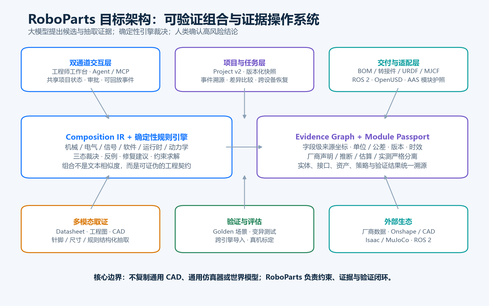
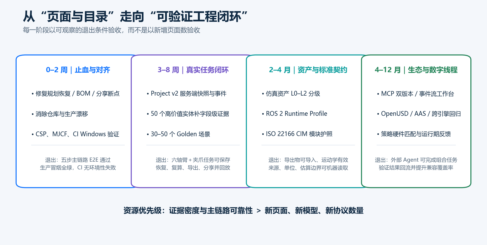

# RoboParts 全面提升与前沿演进报告

**审计日期：** 2026-10-26  
**审计对象：** `C:\Users\xing\Desktop\robopart` 及 `https://roboparts.cc` 的抽样生产回探  
**视角：** 机器人系统工程、AI 产品与工程、目标用户任务  
**核心议题：** 项目完整性、科技价值、互动与流程、实用性、易用性、前沿定位，以及可执行的高层次升级路径

---

## 0. 执行摘要

### 0.1 一句话判断

**RoboParts 已经具备一个有技术辨识度的内核——面向具身系统的三态组合裁决、证据约束和 fail-closed 工程纪律；但当前竞争优势尚未转化为稳定、可信、可复用的用户闭环。下一阶段不应继续做“更大的零件目录”，而应把它升级为“具身系统的可验证组合与证据操作系统”。**

这一定位与项目现有“具身系统组合校验层”的锚点一致，不是另起方向。项目最值得保留的不是 41 个页面，也不是 868 条实体，而是：**把“能、不能、不知道”作为一等结果，把证据作为裁决前提，把不确定性强约束地暴露给用户。**[README](kimi-cite://md-line?path=C%3A%5CUsers%5Cxing%5CDesktop%5Crobopart%5CREADME.md&line=1 "citation")

### 0.2 当前最值钱的五项资产

1. **三态、可溯源的组合判定思想。** 与单纯字符串匹配、相似度推荐或 LLM 自由回答相比，具备成为工程基础设施的可能。
2. **关系建模已开始突破二段互插。** 共装关系、端口预算、类型错误、确定性负答案，说明项目正在从“兼容表”走向“组合语义”。
3. **质量文化强于一般早期 AI 项目。** 变异测试、阴阳自证、缺口登记、来源分级、隔离区、口径说明都已经存在，不是纸面规划。
4. **工程师与 Agent 双入口已有雏形。** 网站、API、MCP、导出工具和统一项目对象，使“人机共用同一工程状态”具备改造基础。
5. **中立性可形成长期信任。** 不靠交易佣金、不卖零件的定位，有利于把兼容性结论做成行业公共语言。[README](kimi-cite://md-line?path=C%3A%5CUsers%5Cxing%5CDesktop%5Crobopart%5CREADME.md&line=27 "citation")

### 0.3 当前最关键的五个断点

| 断点 | 现状判断 | 直接后果 | 首要动作 |
|---|---|---|---|
| 证据密度 | 实体规模明显大于可裁决知识规模 | 用户能检索，却常不能得到确定工程答案 | 从“扩实体”转为“补高价值组合证据” |
| 流程可靠性 | 统一项目状态已接入，但恢复、分享等路径仍有实现断点 | 五步流水线看似连通，实际不能稳定完成任务 | 用真实浏览器 E2E 验收主链路 |
| 资产真实性 | XML 导出存在，但真实 CAD/运动学/物理验证不足 | “可下载”容易被误解为“可仿真、可制造” | 建立资产等级和机器可验证契约 |
| 生产一致性 | 仓库新增能力不等于线上生效，线上数据时间也与本地不一致 | 文档、测试和用户看到的不是同一个产品 | 建立版本指纹、部署清单和生产冒烟 |
| 产品聚焦 | 页面、数据、研究和商业面较宽，主任务被分散 | 新用户难以理解最短价值路径 | 以“10 分钟完成可验证构建”为唯一北极星流程 |

### 0.4 战略选择

未来 12 个月建议依次占据四层位置：

- **设计期：组合类型检查器。** 像 TypeScript 检查类型一样检查机械、电气、信号、软件、运行时和动力学约束。
- **构建期：约束与修复编译器。** 不只报告冲突，还生成转接件、替代件、线束、供电、协议桥接等可解释修复方案。
- **仿真期：资产契约与验证层。** 不复制 Isaac Sim 或 MuJoCo，而保证导出资产的结构、运动学、参数来源和跨引擎行为可验证。
- **运行期：模块护照与持续兼容性层。** 将设计期证据延伸到固件、配置、维护、替换和数字产品护照。

### 0.5 建议资源重排

**未来一个季度，建议把新增页面、泛化扩库和非核心商业功能的预算，优先转向：40% 证据与数据质量、30% 主流程与生产可靠性、20% 仿真/运行时契约、10% 前沿试验。**

---

## 1. 审计方法、证据等级与边界

### 1.1 本次实际执行

- 静态扫描页面、数据、Functions、脚本、文档、依赖和资产类型。
- 用独立脚本现算实体、品类、证据、机械接口和页面接入情况，结果保存在审计快照中。[审计快照](kimi-cite://md-line?path=C%3A%5CUsers%5Cxing%5CDesktop%5Crobopart%5Coutputs%5Caudit_snapshot.json&line=1 "citation")
- 复验 Node 单元测试与仓库 CI 总闸门，保留原始日志。[单元测试日志](kimi-cite://md-line?path=C%3A%5CUsers%5Cxing%5CDesktop%5Crobopart%5Coutputs%5Cnode_unit_20261026.log&line=1 "citation"), [CI 日志](kimi-cite://md-line?path=C%3A%5CUsers%5Cxing%5CDesktop%5Crobopart%5Coutputs%5Cci_gate_20261026.log&line=164 "citation")
- 阅读组合进度、统一项目对象、规划/BOM、URDF/MJCF、Copilot、MCP、API 契约、性能、多租户和部署配置。
- 回探生产 URDF 接口，并用浏览器抽样检查构建规划页面。
- 围绕 VLA、世界模型、仿真、OpenUSD、ROS 2、MCP、Agent UI、CAD/PDM、工业数字孪生和 ISO 模块化标准完成 12 轮定向研究。

### 1.2 三层验收口径

本报告严格区分：

1. **仓库存在：** 文件、函数或数据结构已经出现。
2. **实现可靠：** 本地路径经测试证明可按预期工作。
3. **生产生效：** 已部署版本、数据与线上行为一致，并通过生产冒烟。

这是本项目当前最重要的管理改进之一。**“代码已写”不能再作为完成定义；完成必须至少包含自动化验收与生产验证。**

### 1.3 未覆盖范围

本次未做真实用户访谈、真机装配、MuJoCo/Isaac 实际运行、安全渗透、付费交易、跨浏览器矩阵和大规模性能压测。因此，报告不会声称已证明制造可行性、仿真物理正确性、企业安全合规或商业付费成立。所有相关建议均设置了后续验证门槛。

---

## 2. 项目量化全景

### 2.1 规模与结构

截至审计日，仓库包含 **41 个根 HTML 页面、82 个 `api/*.json`、57 个 Functions JS、205 个顶层脚本、79 篇 docs Markdown、868 个实体、20 个品类和 113 个隔离实体**。41 页本地均已注入统一 Shell 和项目脚本，但只有 8 页接入 analytics；6 页使用外部 CDN，未发现 SRI。[审计快照](kimi-cite://md-line?path=C%3A%5CUsers%5Cxing%5CDesktop%5Crobopart%5Coutputs%5Caudit_snapshot.json&line=3 "citation"), [审计快照](kimi-cite://md-line?path=C%3A%5CUsers%5Cxing%5CDesktop%5Crobopart%5Coutputs%5Caudit_snapshot.json&line=568 "citation")

实体分布高度偏科：

- 执行器 222、芯片 108、平台 106、传感器 95；
- 连接器、线缆、电源、PCB 各 2；
- 结构件 3，一体化关节 1。[审计快照](kimi-cite://md-line?path=C%3A%5CUsers%5Cxing%5CDesktop%5Crobopart%5Coutputs%5Caudit_snapshot.json&line=10 "citation")

这意味着目录“看起来很大”，但一个真实机器人最需要的完整链路——机械安装、供电、连接器、线束、控制、通信、结构、热与维护——仍容易断在低数量品类上。**问题不是每个品类都要平均，而是高价值参考构建是否闭环。**

### 2.2 证据与可判定性

机械接口状态为 `declared=67 / partial=14 / not_declared=419 / n_a=368`；README 的声明率口径是 16.2%（81/500），严格可判定口径是 57/868，即 6.57%。[审计快照](kimi-cite://md-line?path=C%3A%5CUsers%5Cxing%5CDesktop%5Crobopart%5Coutputs%5Caudit_snapshot.json&line=45 "citation"), [README](kimi-cite://md-line?path=C%3A%5CUsers%5Cxing%5CDesktop%5Crobopart%5CREADME.md&line=15 "citation")

`research_progress` 给出的门控加权完成度为 59.9%，但该分数同时混合了判定能力、关系类型覆盖、基础设施和跨域条件，不能替代裸指标。更关键的是：

- 三轴无序对空间 214,840 对中，只有 262 对得到确定答案；
- 当前 `composed=0`，262 个确定答案均为类型错误；
- 跨角色机械可判定为 63/28,500；
- 共装关系 297/360 可判定，但只有 3 个宿主；
- 类型级裁决为 348/657。[研究进度](kimi-cite://md-line?path=C%3A%5CUsers%5Cxing%5CDesktop%5Crobopart%5Capi%5Cresearch_progress.json&line=105 "citation")

**正确解释不是“composed=0，所以引擎无用”，也不是“59.9%，所以已完成大半”。** 确定性负答案是能力；真正不足是正例证据、跨角色机械取证、通用关系覆盖和可交付组合数量。

### 2.3 工程质量

本次复验结果为：

- Node 单元测试：**5 个测试文件全部通过**；内部断言分别为 12、10、13、67、7 项。[单元测试日志](kimi-cite://md-line?path=C%3A%5CUsers%5Cxing%5CDesktop%5Crobopart%5Coutputs%5Cnode_unit_20261026.log&line=16 "citation")
- 总 CI：**115 项通过、13 项失败，整体 BLOCKED**。失败涉及 agent-discovery、需求信号、README 统计、Golden、BOM 拓扑、反馈回流、推广台账、部署新鲜度、ISO 映射、数据集一致性和单元测试非空。[CI 日志](kimi-cite://md-line?path=C%3A%5CUsers%5Cxing%5CDesktop%5Crobopart%5Coutputs%5Cci_gate_20261026.log&line=164 "citation")
- 其中多项失败伴随 Windows 下命令不可用或 GBK 解码异常，属于测试环境可移植性问题；但 ISO 22166 映射 20 项仅 10 项通过、对外数据时间戳陈旧 7 天、线上数据比本地新 0.6 天，属于需要单独处理的真实项目信号。[CI 日志](kimi-cite://md-line?path=C%3A%5CUsers%5Cxing%5CDesktop%5Crobopart%5Coutputs%5Cci_gate_20261026.log&line=108 "citation"), [CI 日志](kimi-cite://md-line?path=C%3A%5CUsers%5Cxing%5CDesktop%5Crobopart%5Coutputs%5Cci_gate_20261026.log&line=137 "citation")

因此准确结论是：**核心 Node 单元测试通过，但总体验收未通过；不能把环境错误一概当产品缺陷，也不能用“只是 Windows 问题”掩盖全部红灯。**

### 2.4 现状三态表

| 能力 | 仓库存在 | 实现可靠 | 生产生效 | 评价 |
|---|---:|---:|---:|---|
| 统一导航/五步流水线入口 | 是 | 部分 | 抽样页面未见新版 Shell | 需部署对齐 |
| 统一 Project 对象 | 是 | 部分 | 未证明 | 本地存储可用，跨设备分享不成立 |
| 组合三态与证据纪律 | 是 | 多项闸门通过 | 部分 | 最有价值内核 |
| 构建规划恢复 | 是 | 否 | 未证明 | 有明确代码缺陷 |
| BOM 项目恢复 | 是 | 待 E2E | 未证明 | 存在重复添加风险 |
| URDF 通用骨架导出 | 是 | XML 级部分 | 是 | 不等于厂商真实模型 |
| MJCF 导出 | 是 | 有结构缺陷 | 否 | 生产请求仍返回 URDF |
| Copilot 上下文解释 | 是 | 部分 | 部分 | 数字与实体链接需修复 |
| MCP | 是 | 多项覆盖闸门通过 | 有 | 协议版本与描述需更新 |
| 多租户/私有隔离 | 否 | 不适用 | 无 | 当前是单租户公开池 |
| 性能 SLO | 文档有 | 未形成实测闭环 | 未证明 | 多数现状仍“待测” |

---

## 3. 机器人领域专家视角：从“零件关系”走向“系统可构建性”

### 3.1 当前科技价值

RoboParts 的稀缺性不在于收录某个电机或夹爪，而在于尝试把组合问题形式化。尤其是：

- 不把 `unknown` 偷换成兼容或不兼容；
- 识别同针数、同针序仍可能因连接器 family 不同而不可插；
- 把共装中的端口耗尽作为工程约束；
- 对闭源模型和无公开验证硬件栈的关系不强行补全。

这些原则比“再增加 1,000 个零件”更难复制，也更接近机器人系统工程的真实难点。[研究进度](kimi-cite://md-line?path=C%3A%5CUsers%5Cxing%5CDesktop%5Crobopart%5Capi%5Cresearch_progress.json&line=127 "citation")

### 3.2 组合模型需要增加六个维度

当前机械、电气、信号、软件是基础，但“能连上”距离“能工作”仍有明显距离。建议 Composition IR 逐步增加：

1. **机械：** 法兰之外增加基准、方向、包络、干涉、紧固件、工具空间、材料、表面处理、公差链、载荷与疲劳。
2. **电气：** 电压/电流之外增加峰值功率、再生能量、接地、EMC、保险、热插拔、线束压降和故障状态。
3. **信号与实时性：** 协议之外增加周期、抖动、时钟同步、总线负载、QoS、时间戳坐标系和失联策略。
4. **软件与运行时：** ROS 分发版、DDS/RMW、驱动版本、固件、ABI、容器架构、加速库和操作系统。
5. **动力学与控制：** 质量、质心、惯量、关节范围、额定/峰值扭矩、控制频率、稳定性边界和标定状态。
6. **安全与维护：** 安全功能边界、制动、限位、可更换性、生命周期和验证记录。安全相关结论必须保持“辅助检查”，不可由普通兼容分数替代正式安全评估。

### 3.3 数据策略应从“均匀扩库”改为“任务覆盖”

建议先选三类高价值任务：

- 六轴机械臂＋夹爪＋力/触觉传感器；
- 开源人形/双臂平台＋关节＋边缘计算＋数据采集；
- 四足/移动平台＋激光/视觉＋计算单元＋电源。

每类建立一条“最小完整链路”，优先补齐链上的证据，而不是随机增加条目。评价单位为：

> **已验证任务链数 × 每条链的字段级证据完整度 × 可复现交付物数量。**

这样，连接器只有 2 条不再只是“品类少”的抽象问题，而会被具体转换为“哪条参考构建因哪几个针脚、哪个电压或哪根线束无法裁决”。

### 3.4 转接件应从几何生成升级为可制造性检查

当前 SCAD 示例是良好起点，但真正的工程价值来自：输入法兰约束 → 生成几何 → 检查干涉和紧固件 → 校核材料/厚度/载荷 → 输出制造图与假设 → 回收实测结果。建议增加：

- 材料、打印方向、层厚、最小壁厚、孔补偿、公差和嵌件参数；
- 螺栓长度、垫圈、工具操作空间和螺纹啮合；
- 载荷、力臂、安全系数与“未验证”标签；
- 版本化参数快照和打印后实测反馈；
- 高风险场景禁止直接输出“可制造/安全”结论。

### 3.5 仿真资产必须诚实分级

本地 MJCF 代码已明确承认几何是参数化骨架、物理参数是估算值；但实现中关节和 body 未按父子结构正确嵌套，接触对引用了 body 名而未命名 geom，不能直接视为高质量可运行 MJCF。[URDF/MJCF 导出](kimi-cite://md-line?path=C%3A%5CUsers%5Cxing%5CDesktop%5Crobopart%5Cfunctions%5Capi%5Curdf%5Cdownload.js&line=155 "citation"), [URDF/MJCF 导出](kimi-cite://md-line?path=C%3A%5CUsers%5Cxing%5CDesktop%5Crobopart%5Cfunctions%5Capi%5Curdf%5Cdownload.js&line=192 "citation")

生产回探进一步显示：请求 `format=mjcf` 时，线上返回内容仍以 `<robot>` 为根，即 URDF，证明本地新增 MJCF 尚未同步到该生产路径。[生产回探样本](kimi-cite://md-line?path=C%3A%5CUsers%5Cxing%5CDesktop%5Crobopart%5Coutputs%5Clive_URDF-001.mjcf.xml&line=1 "citation")

建议资产等级如下：

| 等级 | 名称 | 必须满足 | 对外可用表述 |
|---|---|---|---|
| L0 | 元数据模型 | 有名称、类型、来源和估算边界 | 参数化元数据 |
| L1 | 结构可解析 | XML Schema/解析器通过，引用完整，单位明确 | 可导入原型 |
| L2 | 运动学有效 | 连杆树、关节轴、限位、坐标系、TCP 经测试 | 运动学原型 |
| L3 | 物理参数可追 | 质量、惯量、摩擦、执行器参数有来源与假设 | 仿真候选资产 |
| L4 | 验证资产 | 跨引擎回归、关键运动学/动力学对照、必要时真机标定 | 已验证仿真资产 |

60 个预设模型由元数据动态生成通用骨架，不应与厂商授权 URDF 混为一谈。[URDF 模型库](kimi-cite://md-line?path=C%3A%5CUsers%5Cxing%5CDesktop%5Crobopart%5Cfunctions%5Capi%5Curdf%5Clibrary.js&line=1 "citation") **建议把“60+ 即开即用”改为按 L0–L4 筛选的真实资产清单。**

---

## 4. AI 项目专家视角：从“有 Copilot”走向“神经—符号工程系统”

### 4.1 大模型应该做什么，不应该做什么

**适合大模型：** 解析自然语言需求、从 datasheet/工程图提出字段候选、对齐实体、解释冲突、生成修复候选、编排工具、总结变更。

**不应交给大模型独立裁决：** 尺寸是否一致、针脚是否匹配、供电是否越界、协议是否实时、质量/惯量是否真实、安全是否满足、仿真资产是否通过验证。

推荐原则：

> **LLM 提出假设，确定性引擎负责裁决，证据图谱负责解释，人类负责高风险确认。**

这样既利用多模态模型降低取证成本，又不破坏项目已有的 fail-closed 信用。

### 4.2 建立字段级多模态取证流水线

建议把当前 VLM 队列扩展为以下可度量流程：

1. 文档解析：PDF 页、表、图、脚注、版本和页码坐标；
2. 候选抽取：字段值、单位、公差、适用型号、条件和证据框；
3. 规范化：SI 单位、接口类型、型号变体、枚举映射；
4. 独立校验：第二抽取器/规则/OCR 交叉核对，而非同一模型自评；
5. 风险分级：关键尺寸、针脚、供电和限位强制人工批准；
6. 入库：字段级 PROV、文档哈希、模型版本、审核人、时效；
7. 回归：Golden 文档集、对抗样本、字段漂移和误抽率监控。

多模态文档抽取研究已经强调结构化输出和视觉证据定位的重要性；工程场景更应以尺寸、针脚和规则是否可导入、可独立校验来验收，而不是以生成文本“读起来正确”验收。[ChartGemma 等结构化图表研究](kimi-cite://web?url=https%3A%2F%2Farxiv.org%2Fhtml%2F2404.07917v1 "citation"), [工程文档多模态抽取研究](kimi-cite://web?url=https%3A%2F%2Farxiv.org%2Fhtml%2F2606.19795v2 "citation")

### 4.3 Copilot 应升级为共享项目状态上的工作台

当前后端是多模型请求—响应代理，有降级和基础 grounding，但还存在两处基础信用问题：系统提示硬编码“声明率约 1.52%”，与当前 16.2% 口径不一致；实体引用统一指向 `/bionic`，没有深链到具体实体。[Copilot 后端](kimi-cite://md-line?path=C%3A%5CUsers%5Cxing%5CDesktop%5Crobopart%5Cfunctions%5Capi%5Ccopilot.js&line=94 "citation"), [Copilot 后端](kimi-cite://md-line?path=C%3A%5CUsers%5Cxing%5CDesktop%5Crobopart%5Cfunctions%5Capi%5Ccopilot.js&line=187 "citation")

建议目标体验不是“右侧聊天框”，而是：

- 左侧：需求、当前组合、约束和缺失证据；
- 中间：组合图、冲突位置、可替代方案；
- 右侧：Agent 任务流、工具调用、待审批动作和引用；
- 底部：项目版本、事件时间线、复算与回滚。

Agent 每次操作都生成结构化事件，例如 `requirement.updated`、`candidate.proposed`、`evidence.attached`、`verdict.computed`、`adapter.generated`、`human.approved`。用户可暂停、修改约束、只重跑受影响节点，并比较两个版本的 BOM、成本、质量和 unknown 变化。

A2A 的任务状态和 AG-UI 的 Agent—用户交互思路，适合用作这一工作台的协议参考，而不是只增加一个聊天 UI。[A2A 规范](kimi-cite://web?url=https%3A%2F%2Fa2a-protocol.org%2Flatest%2Fspecification%2F "citation"), [AG-UI 文档](kimi-cite://web?url=https%3A%2F%2Fdocs.ag-ui.com%2Fintroduction "citation")

### 4.4 MCP 要做双版本适配与可回放任务

当前包依赖 `@modelcontextprotocol/sdk:^1.0.4`，描述仍写 798 实体，与 868 现状不一致。[MCP 包配置](kimi-cite://md-line?path=C%3A%5CUsers%5Cxing%5CDesktop%5Crobopart%5Cmcp-server%5Cpackage.json&line=1 "citation")

MCP 2026-07-28 规范与路线图强调无状态核心、服务发现、缓存 TTL、多轮输入、Tasks 和 Trace 等方向。建议：

- 保留旧客户端兼容层，新增协议版本协商，不做一次性破坏升级；
- 工具输入输出全部引用 `project_id + revision + evidence_version`；
- 长任务返回任务句柄、进度、可取消状态和最终结果；
- 把“为什么 unknown”“哪条证据导致冲突”作为标准工具，而非仅靠自然语言解释；
- 为每次外部 Agent 调用保存可去敏回放的评估轨迹。[MCP 规范](kimi-cite://web?url=https%3A%2F%2Fmodelcontextprotocol.io%2Fspecification%2F2026-07-28%2F "citation"), [MCP 路线图](kimi-cite://web?url=https%3A%2F%2Fblog.modelcontextprotocol.io%2Fposts%2Fmcp-roadmap%2F "citation")

### 4.5 建立 AI 项目的双层评估

**离线层：** 字段抽取准确率、单位错误率、证据定位准确率、组合裁决 Golden、unknown 保持率、反例发现率、工具调用成功率、 replay 一致性。

**在线层：** 首次任务成功率、人工修正次数、从需求到有效 BOM 的时间、分享恢复成功率、生产失败率、外部 Agent 完成任务数。

任何模型升级都必须同时通过“回答质量”和“工程约束不被破坏”两类门禁，不能只比较通用 benchmark 或主观语感。

---

## 5. 用户视角：以 10 分钟可验证构建为主任务

### 5.1 建议的北极星任务

> **用户输入“我要做一套 6 轴臂＋二指夹爪，负载 2 kg，ROS 2，预算和尺寸受限”，10 分钟内得到可解释的组合、冲突、缺失证据、BOM、转接方案和仿真原型，并能保存、恢复、复算和分享。**

### 5.2 当前主链路的具体断点

**构建规划恢复存在确定性代码问题。** 恢复代码被放在带 `src` 的 `<script>` 元素内部，浏览器会忽略其内联内容；同时调用了不存在的 `selectType`，页面还重复加载 `_shell.js`。[构建规划页](kimi-cite://md-line?path=C%3A%5CUsers%5Cxing%5CDesktop%5Crobopart%5Cbuild-planner.html&line=223 "citation")

**BOM 初始化存在重复添加风险。** 恢复成功分支之外，数据加载结束后仍无条件执行 `addPick(); addPick();`。[BOM 检查页](kimi-cite://md-line?path=C%3A%5CUsers%5Cxing%5CDesktop%5Crobopart%5Cbom-checker.html&line=168 "citation")

**分享链接并不具备跨设备能力。** `shareUrl()` 只生成 `?rp=<id>`，`fromUrl()` 只查询当前浏览器 localStorage；没有服务端快照或链接内数据，因此另一台设备无法凭该 ID 恢复。[统一项目对象](kimi-cite://md-line?path=C%3A%5CUsers%5Cxing%5CDesktop%5Crobopart%5Crp-project.js&line=223 "citation"), [统一项目对象](kimi-cite://md-line?path=C%3A%5CUsers%5Cxing%5CDesktop%5Crobopart%5Crp-project.js&line=239 "citation")

### 5.3 目标流程与验收

| 步骤 | 用户看到什么 | 系统必须做什么 | 失败恢复 | 验收标准 |
|---|---|---|---|---|
| 1. 描述需求 | 自然语言＋关键约束表单 | 结构化负载、尺寸、预算、ROS、环境 | 缺字段时只问阻塞项 | 3 分钟内形成需求快照 |
| 2. 生成候选 | 2–3 套组合及差异 | 确定性筛选＋解释，不用相似度冒充兼容 | 可锁定零件重算 | 每个结论可点证据 |
| 3. 处理冲突 | 冲突位置和修复排序 | 转接、替代、桥接、供电等修复候选 | 保留原方案，生成分支 | 冲突不丢失、可比较 |
| 4. 检查交付 | BOM、unknown、装配次序 | 全链复算，标出启发式与证据结果 | 一键定位缺口 | 无静默覆盖用户输入 |
| 5. 导出与分享 | URDF/MJCF/BOM/只读链接 | 资产分级、版本指纹、服务端快照 | 可回滚到任意 revision | 新浏览器可完整恢复 |

### 5.4 易用性提升原则

- **首屏只突出一个主动作：** “开始一个可验证构建”，目录、研究、API、标准等退为辅助入口。
- **unknown 要可行动：** 不只显示“不知道”，还显示缺哪个字段、为何阻塞、去哪找、上传什么、提交后会影响哪些组合。
- **减少认知跳转：** 当前项目名、版本、进度和未解决问题始终可见；五页之间不重复录入。
- **所有自动修复可撤销：** AI 不得直接覆盖人工锁定值。
- **专业与简洁并存：** 默认显示结论和修复，高级用户可展开完整约束、公式和证据。
- **全站度量而非抽样度量：** 当前只有 8/41 页有 analytics，无法可靠还原端到端漏斗；至少对主链路统一埋点，同时提供隐私开关和去标识化。[审计快照](kimi-cite://md-line?path=C%3A%5CUsers%5Cxing%5CDesktop%5Crobopart%5Coutputs%5Caudit_snapshot.json&line=568 "citation")

---

## 6. 竞品与前沿生态：不要硬拼规模，要占据验证层

| 生态/竞品 | 对方优势 | 不应硬拼的部分 | RoboParts 的互补位置 |
|---|---|---|---|
| TraceParts / PARTcommunity / Octopart | 厂商授权 CAD、海量目录、原生格式、库存与采购信息 | 不复制全量 CAD 和供应链目录 | 跨厂商组合约束、证据图谱、冲突与修复 |
| Onshape / 云 CAD+PDM | 参数化 B-rep、版本、协作、FeatureScript、PDM | 不自建通用 CAD 内核 | 约束驱动组合编辑器、CAD 前置检查与验证回写 |
| Isaac Sim / MuJoCo / OpenUSD | 高保真仿真、渲染、物理、合成数据、资产生态 | 不自建通用仿真器和世界模型 | 资产契约、参数来源、跨引擎回归、组合导出 |
| GR00T / Gemini Robotics / VLA | 全身控制、感知、任务规划、多机器人协作 | 不训练通用机器人基础模型 | 策略—硬件能力契约、可部署性检查、验证硬件栈 |
| ROS 2 | 运行时、驱动、消息、工具链和庞大社区 | 不另造机器人中间件 | Runtime Profile、驱动/固件/实时性兼容矩阵 |
| MCP / A2A / AG-UI | Agent 工具、任务与交互协议 | 不发明封闭的新协议 | 把组合与证据能力以标准协议暴露给所有 Agent |

TraceParts 已将制造商 CAD 模型直接接入 Octopart，说明“目录＋CAD＋采购”正在被强生态整合；RoboParts 若以数量和下载格式正面竞争，很难形成优势。[TraceParts](kimi-cite://web?url=https%3A%2F%2Finfo.traceparts.com%2Fnews%2Ftraceparts-news%2Ftraceparts-cad-models-are-now-directly-available-from-octopart-com%2F "citation")

Onshape 已把云 CAD、FeatureScript、MCP 和机器人仿真工作流连接起来。RoboParts 的设计画布应聚焦“组合图和约束”，高保真 B-rep 交给 Onshape、OpenCascade 或 CadQuery。[Onshape FeatureScript MCP](kimi-cite://web?url=https%3A%2F%2Fwww.ptc.com%2Fen%2Fnews%2F2026%2Fonshape-launches-featurescript-mcp-server "citation"), [Onshape FeatureScript](kimi-cite://web?url=https%3A%2F%2Fwww.onshape.com%2Fen%2Fblog%2Ffeaturescript-custom-cad-features-vs-macros-api "citation")

---

## 7. 前沿趋势到产品能力的映射

### 7.1 VLA 全身化：从零件兼容升级为“策略—躯体契约”

NVIDIA GR00T 与 Isaac Lab 的方向是模型、仿真、全身控制和部署闭环；Gemini Robotics 2 / ER 2 强调全身智能、长任务进度、工具调用、多机器人协作和跨本体适配。[NVIDIA](kimi-cite://web?url=http%3A%2F%2Fnvidianews.nvidia.com%2Fnews%2Fnvidia-and-global-robotics-leaders-take-physical-ai-to-the-real-world "citation"), [Isaac GR00T](kimi-cite://web?url=https%3A%2F%2Fgithub.com%2FNVIDIA%2FIsaac-GR00T "citation"), [Gemini Robotics 2](kimi-cite://web?url=https%3A%2F%2Fdeepmind.google%2Fblog%2Fgemini-robotics-2-brings-whole-body-intelligence-to-robots%2F "citation"), [Gemini Robotics ER 2](kimi-cite://web?url=https%3A%2F%2Fdeepmind.google%2Fblog%2Fgemini-robotics-er-2-powering-robotics-with-video-understanding-task-orchestration-and-multi-robot-collaboration%2F "citation")

**RoboParts 应新增 Policy Hardware Profile：** 动作空间、控制频率、观测模态、关节顺序、坐标系、 embodiment 绑定、推理时延、算力、内存、标定和安全回退。最终回答的不只是“模型能否在这块芯片运行”，而是“这个策略能否驱动这副身体完成这个任务，以及证据是什么”。

### 7.2 世界模型：做符号真值层，不做另一个生成模型

世界模型可生成环境和交互候选，但视觉连贯不等于尺寸、力学、电气和制造约束正确。Cosmos 等技术越强，越需要独立、可验证的工程约束层来过滤不可构建方案。[Cosmos 3 技术报告](kimi-cite://web?url=https%3A%2F%2Fresearch.nvidia.com%2Flabs%2Fcosmos-lab%2Fcosmos3%2Ftechnical-report.pdf "citation")

推荐协作方式：

> 生成模型提出构型 → RoboParts 检查工程约束 → 仿真器验证动力学 → 真机/实测回流证据。

不建议自建通用世界模型。可先做一个小而清晰的“神经—符号协同设计”实验：生成 20 个夹爪安装方案，由规则引擎淘汰冲突，再由仿真验证剩余方案，全程记录淘汰原因。

### 7.3 OpenUSD 与多物理：XML 导出不再构成壁垒

Isaac Sim 6 已覆盖 URDF/MJCF、OpenUSD、多物理与资产转换工作流。未来竞争力不是“多一种 XML”，而是模型是否真实、单位是否一致、关节树是否正确、参数是否可追、跨引擎结果是否可解释。[Isaac Sim 6](kimi-cite://web?url=https%3A%2F%2Fdocs.isaacsim.omniverse.nvidia.com%2F6.0.0%2Foverview%2Frelease_notes.html "citation"), [Newton Physics](kimi-cite://web?url=https%3A%2F%2Fdocs.isaacsim.omniverse.nvidia.com%2F6.0.1%2Fphysics%2Fnewton_physics.html "citation"), [OpenUSD 机器人工作流](kimi-cite://web?url=https%3A%2F%2Fdeveloper.nvidia.com%2Fblog%2F3-easy-ways-to-supercharge-your-robotics-development-using-openusd%2F "citation")

建议维护一个中性 Composition IR，再由 URDF/MJCF/USD 导出器投影。不要把 URDF 当主数据模型，否则运行时、电气、证据和生命周期信息会持续被迫塞进注释。

### 7.4 ROS 2 Lyrical：兼容判定要进入运行时

ROS 2 Lyrical Luth 是 2026 LTS，支持周期到 2031；Zenoh、GPU 零拷贝、异步执行和在线 robot description 等方向意味着“机器人模型”越来越不是静态文件，而是运行系统的一部分。[ROS 2 Lyrical](kimi-cite://web?url=https%3A%2F%2Fdocs.ros.org%2Fen%2Frolling%2FReleases%2FRelease-Lyrical-Luth.html "citation"), [ROS 2 发布说明](kimi-cite://web?url=https%3A%2F%2Fdiscourse.openrobotics.org%2Ft%2Fros-2-lyrical-luth-released%2F55021 "citation")

建议建立 `ROSRuntimeProfile`：分发版、RMW、DDS/QoS、消息版本、驱动、控制周期、时间同步、加速库、robot description 来源和启动测试。把它纳入组合裁决和 CI，而不是只在零件页显示“支持 ROS 2”。

### 7.5 ISO 22166、AAS 与 DPP：从实体卡片升级为模块护照

ISO 22166-201 的通用信息模型关注模块识别、选型、集成和运维，并涉及 Status、Services、Safety/Security、Modelling、Executable Form；22166-203 的硬件信息模型仍在发展。[ISO 22166-201](kimi-cite://web?url=https%3A%2F%2Fwww.iso.org%2Fobp%2Fui%2Fen%2F%23!iso%3Astd%3A82334%3Aen "citation"), [ISO 目录](kimi-cite://web?url=https%3A%2F%2Fwww.iso.org%2Fcommittee%2F5915511%2Fx%2Fcatalogue%2Fp%2F1%2Fu%2F1%2Fw%2F0%2Fd%2F0 "citation")

AAS 子模型和 OPC UA/CEN/CENELEC 的数字产品护照协作表明，工业数据正从设计期目录延伸到运行和生命周期。[AAS 子模型](kimi-cite://web?url=https%3A%2F%2Findustrialdigitaltwin.org%2Fen%2Fcontent-hub%2Fsubmodels "citation"), [OPC Foundation DPP](kimi-cite://web?url=https%3A%2F%2Fopcfoundation.org%2Fnews%2Fpress-releases%2Fopc-foundation-and-cen-cenelec-strengthen-cooperation-on-digital-product-passport-standardization%2F "citation")

建议 RoboParts Module Passport 至少包含：

- 身份：厂商、型号、变体、序列/批次、版本；
- 接口：机械、电气、信号、软件、运行时；
- 能力：负载、速度、精度、环境、控制与观测；
- 证据：字段级来源、实测、证书、时效、审核；
- 资产：CAD、URDF/MJCF/USD、驱动、标定；
- 生命周期：固件、维护、替换、兼容变更和退役。

这比“兼容性网站”更高一层，却仍复用现有实体、证据和裁决内核。

---

## 8. 目标技术与产品架构

### 8.1 六个核心组件

1. **Composition IR：** 与页面和导出格式解耦，描述节点、端口、约束、关系、策略、运行时和验证结果。
2. **Evidence Graph：** 字段级证据、来源坐标、单位、版本、推导过程和审核状态。
3. **Policy/Rule Engine：** 确定性三态裁决、约束求解、反例和修复排序；AI 只能提交候选事实。
4. **Project Event Store：** 版本化项目、事件溯源、差异比较、协作与回放。
5. **Agent/UI 双通道：** 工程师和 Agent 操作同一项目状态，不维护两套业务逻辑。
6. **Export & Verification：** BOM、转接件、URDF/MJCF/USD、ROS Profile、AAS 护照及验证报告。

### 8.2 为什么必须是事件溯源

组合项目会经历需求变化、替换件、证据更新、人工覆盖、仿真失败和真机反馈。只保存最终 JSON 无法回答：

- 谁把额定电压从 24 V 改成 48 V？
- 哪个新证据让兼容变成不兼容？
- 这次仿真失败对应哪个 BOM 版本？
- AI 的修复究竟改了多少约束？

事件溯源使“可解释 AI”从一段文字升级为可重放过程，也使企业协作和审计有基础。

### 8.3 不必立即上重型微服务

建议在现有 Cloudflare 架构上演进：

- Project v2：服务端快照、revision、哈希和只读分享 token；
- 事件先采用 append-only JSON/对象存储，量产后按需求迁移数据库；
- Composition IR 与规则核心保持纯函数、可本地测试；
- AI 任务与规则计算分离，支持重试和取消；
- 数据公开池与私有项目明确分边界。

当前项目明确仍是单租户公开池，真正多租户涉及存储、鉴权、数据面、计费和合规，不能在分享功能上线时顺带宣称企业级隔离。[多租户边界](kimi-cite://md-line?path=C%3A%5CUsers%5Cxing%5CDesktop%5Crobopart%5Cdocs%5Cmulti-tenancy.md&line=1 "citation")

---

## 9. 可落地 Backlog

> 工作量为粗略工程人日，用于相对排序，不是承诺工期；默认一名熟悉仓库的工程师，数据取证另计。每项必须通过验收才算完成。

### 9.1 P0：0–2 周，先恢复可信度

| 编号 | 任务与改动位置 | 工作量 | 依赖 | 验收指标 |
|---|---|---:|---|---|
| P0-1 | 修复 `build-planner.html` 恢复脚本、函数名和重复 Shell | 1–2 | 无 | 刷新/前进后退/新会话均恢复；控制台零错误 |
| P0-2 | 修复 `bom-checker.html` 初始化，保留用户行，不重复添加 | 1–2 | P0-1 | 恢复后行数和内容完全一致；样本与空项目均通过 |
| P0-3 | 将“分享”临时改为诚实口径，或实现最小服务端只读快照 | 2–5 | 分享 API | 无缓存的新浏览器可恢复同 revision；私有数据不泄露 |
| P0-4 | 建立部署指纹：commit、数据版本、构建时间、功能清单 | 2–3 | CI/CD | 页脚/API 可查询；线上与预期 commit 一致 |
| P0-5 | 生产冒烟：Shell、五步流程、MJCF 根元素、关键 API | 3–5 | P0-4 | 每次部署自动运行；失败阻断发布或自动回滚 |
| P0-6 | 校验 `_headers` CSP 与 6 页 CDN；优先自托管并锁定版本 | 2–4 | 构建策略 | 生产 Three.js/XLSX 页面无 CSP 阻断；第三方依赖可审计 |
| P0-7 | 修复 MJCF body/joint 嵌套、geom 命名、接触引用和单位 | 3–5 | MuJoCo 测试环境 | 典型资产实际加载/step；父子结构与 URDF 一致 |
| P0-8 | 修复 Copilot 1.52% 陈旧数字与实体深链 | 1–2 | 实体 URL 契约 | 数字由真相源生成；引用打开对应实体 |
| P0-9 | 修复 Windows 子进程和 UTF-8 解码，分离环境失败与产品失败 | 2–4 | CI | Windows/Linux 均执行同一批测试；无“命令未运行却算测过” |
| P0-10 | 统一 Node 版本：根要求、Docker、CI、文档 | 1 | 无 | 所有环境同一大版本；容器握手和自测通过 |
| P0-11 | 处理 13 项红灯并建立失败分类台账 | 3–8 | P0-9 | 总 CI 全绿；真实缺陷与环境问题分别有证据 |
| P0-12 | 资产文案全面改为 L0–L4，不宣称估算骨架“仿真就绪” | 1–2 | 资产 Schema | 每个下载项显示等级、来源、假设和验证状态 |

当前 CSP 的 `script-src` 未包含 jsDelivr，而 6 个页面使用该 CDN，故 P0-6 应在生产环境实测，不应只检查静态文本。[安全响应头](kimi-cite://md-line?path=C%3A%5CUsers%5Cxing%5CDesktop%5Crobopart%5C_headers&line=15 "citation") 根包要求 Node `>=22.22.0`，Docker 仍使用 Node 20，也应统一。[项目包配置](kimi-cite://md-line?path=C%3A%5CUsers%5Cxing%5CDesktop%5Crobopart%5Cpackage.json&line=12 "citation"), [Dockerfile](kimi-cite://md-line?path=C%3A%5CUsers%5Cxing%5CDesktop%5Crobopart%5CDockerfile&line=7 "citation")

### 9.2 P1：3–8 周，打通真实任务闭环

| 编号 | 任务 | 工作量 | 依赖 | 验收指标 |
|---|---|---:|---|---|
| P1-1 | Project v2：服务端快照、revision、事件、差异、只读分享 | 10–15 | P0 | 五步全链保存/恢复/复算/回放；冲突不静默覆盖 |
| P1-2 | 定义 Composition IR v1，把五页输入输出映射到同一模型 | 8–12 | P1-1 | 任一页面变更可追踪；导出结果来自同一 IR |
| P1-3 | 建立 30–50 个端到端 Golden 场景 | 8–15 | 规则核心 | 正例、负例、unknown、修复和回归均覆盖；变异能杀死错误 |
| P1-4 | 选 50 个高价值实体，补机械＋电气＋信号字段级证据 | 15–30 | 取证流程 | 三条参考链关键字段 100% 有坐标化证据 |
| P1-5 | 扩展宿主与真实正例，优先共装和跨角色机械关系 | 10–20 | P1-4 | 已验证正组合数、宿主数、L2/L3 有可解释增长 |
| P1-6 | 主链路统一埋点与漏斗，不只统计 page view | 4–6 | 隐私策略 | 可计算首次任务成功率、耗时、退出点和恢复率 |
| P1-7 | 主链路真实浏览器 E2E：桌面/移动、刷新、离线、失败重试 | 6–10 | P0、P1-1 | 核心 20 条用例全绿；失败保留截图和项目 revision |
| P1-8 | API Schema 优先覆盖项目、组合、裁决、证据、导出 | 5–8 | IR v1 | 破坏性变更被 CI 拦截；版本头与 Schema 一致 |

当前 API 版本文档中，大量数据文件的契约仍未定义，需优先覆盖主链路而不是一次性为所有静态 JSON 写形式化 Schema。[API 版本化契约](kimi-cite://md-line?path=C%3A%5CUsers%5Cxing%5CDesktop%5Crobopart%5Cdocs%5Capi-versioning.md&line=42 "citation")

### 9.3 P2：2–4 月，形成资产与标准壁垒

| 编号 | 任务 | 工作量 | 验收指标 |
|---|---|---:|---|
| P2-1 | Evidence Graph 与字段级 PROV | 15–25 | 任意裁决可下钻到原始页/表/图和推导链 |
| P2-2 | 仿真资产 L0–L4 与自动验证报告 | 15–25 | L1/L2 全自动；L3/L4 明示人工/实测边界 |
| P2-3 | ROSRuntimeProfile 与启动测试 | 10–20 | 参考构建在目标 ROS 2 环境实际启动，驱动/消息/QoS 可追 |
| P2-4 | CIM Module Passport，映射 ISO 22166 服务能力 | 12–20 | 条款映射由 10/20 提升并有真实机器校验，不以文档映射冒充认证 |
| P2-5 | OpenUSD/AAS 导出试验 | 10–20 | 同一 IR 可导出并回读，关键语义不丢失 |
| P2-6 | MCP 双版本、任务句柄、Trace 与回放 | 10–15 | 新旧客户端均通过契约测试；长任务可取消、恢复 |
| P2-7 | AG-UI 风格事件流工作台 | 10–20 | 用户可审批、暂停、修改约束和比较 revision |
| P2-8 | 跨引擎仿真回归 | 15–30 | 参考模型的运动学/关键动力学指标有容差报告 |

### 9.4 P3：4–12 月，在前沿层建立复利

1. **神经—符号协同设计：** 生成模型提构型，规则引擎剪枝，仿真和实测回流。
2. **Policy Hardware Matching：** 为 VLA/策略建立可部署性和躯体能力契约。
3. **运行期数字线程：** 固件、配置、维护和替换件触发兼容性重算。
4. **供应商验证网络：** 厂商签署字段级声明，用户实测作为独立证据，不与厂商声明混写。
5. **可信开放基准：** 发布可复现组合任务、unknown 集、反例集和跨引擎验证结果，形成行业标准影响力。

---

## 10. 分阶段路线图与退出条件

### 阶段 A：0–2 周——止血与对齐

**目标：** 用户看到的线上产品、仓库代码和文档口径一致。

退出条件：

- 五步主链路 E2E 全绿；
- 构建规划、BOM、分享/恢复无已知阻断缺陷；
- MJCF 生产返回真正 MJCF 且测试资产可加载；
- CI 无环境性假失败，13 项红灯全部关闭或有明确修复记录；
- 所有资产和 AI 结论不再出现陈旧、夸大或不可追溯表述。

### 阶段 B：3–8 周——真实任务闭环

**目标：** 一个目标用户能完成完整任务，而不是浏览多个功能页。

退出条件：

- 六轴臂＋夹爪参考任务可保存、恢复、复算、导出、分享和回放；
- 至少 30 个 Golden 端到端场景；
- 50 个高价值实体完成字段级证据增强；
- 首次任务成功率、完成时间和恢复成功率有基线。

### 阶段 C：2–4 月——资产与标准契约

**目标：** 从“兼容性数据”升级为“可执行工程契约”。

退出条件：

- L0–L2 资产自动分级和验证；
- 参考构建具备 ROS 2 Runtime Profile；
- Module Passport 覆盖身份、接口、证据、资产和生命周期；
- 外部 Agent 可通过 MCP 完成同一组合任务。

### 阶段 D：4–12 月——生态与数字线程

**目标：** 形成“证据越多—裁决越准—验证越多—生态越可信”的复利。

退出条件：

- OpenUSD/AAS 和跨引擎验证进入参考流程；
- 策略—硬件匹配有公开 Golden；
- 真实运行/维护反馈可触发项目重算；
- 外部用户或厂商持续贡献可审核证据，而非仅由团队填库。

---

## 11. KPI 重构：从规模指标转向可信任务指标

### 11.1 北极星指标

**每月由独立用户或外部 Agent 完成、且可复现验证的“组合任务数”。**

完成必须同时满足：有项目 revision、有确定性裁决、有证据、有交付物、可重新运行，而非只点击“生成”。

### 11.2 下一次评审只看十项

| 指标 | 当前基线 | 下一目标建议 | 说明 |
|---|---|---|---|
| 已验证正组合数 | peer-to-peer `composed=0` | 先达到 20 个高价值正例 | 不追求全空间，追求真实任务 |
| 跨角色机械可判定率 | 63/28,500 | 分母不变时持续提升；同时报绝对数 | 防止只改分母 |
| 共装宿主覆盖 | 3 | 10 个高价值宿主 | 与参考任务绑定 |
| 完整参考链路 | 未形成统一验收 | 3 条 | 机械、电气、信号、软件、运行时齐全 |
| 五步任务一次成功率 | 未测 | 建立基线后 ≥80% | 以真实浏览器 E2E/用户任务计 |
| 跨浏览器/设备恢复率 | 分享不成立 | ≥99% 技术冒烟 | 同 revision、同内容 |
| 生产部署漂移 | 已发现数据与功能漂移 | 0 次未解释漂移 | commit＋数据版本双指纹 |
| 字段级抽取严重错误率 | 未测 | 关键字段独立校验，目标 <1% | 尺寸/针脚/供电单独统计 |
| 仿真资产导入与运动学通过率 | 未测 | L1/L2 参考集 100% | 不用 XML 可解析代替运动学正确 |
| 外部 Agent 成功任务数 | 未测 | 建立基线并逐月增长 | 必须可回放、可复核 |

### 11.3 应降级为辅助指标的口径

页面数、实体总数、文档数、模型数量、工具数量和加权完成度可继续展示，但不应成为主要资源分配依据。59.9% 这类加权值适合内部观察，不适合替代上述任务结果。[研究进度](kimi-cite://md-line?path=C%3A%5CUsers%5Cxing%5CDesktop%5Crobopart%5Capi%5Cresearch_progress.json&line=40 "citation")

性能指标也应从“待测”变成真实 SLO。当前性能预算多数现状仍待测，脚本亦标为待实现；建议先把首页、实体数据、关键 API、主链路和 Workers 错误率接入自动测量。[性能预算](kimi-cite://md-line?path=C%3A%5CUsers%5Cxing%5CDesktop%5Crobopart%5Cdocs%5Cperformance-budget.md&line=17 "citation")

---

## 12. 风险、边界与明确不做什么

### 12.1 五条不可突破的信用边界

1. **不把估算物理参数伪装成厂商值或实测值。**
2. **不把 XML 可导出称为仿真就绪，不把骨架称为厂商真实模型。**
3. **不为降低 unknown 让 LLM 猜尺寸、针脚、功率或安全参数。**
4. **不以新增页面代替端到端流程，不以单元测试通过代替生产验收。**
5. **不在单租户公开池上宣称私有隔离、企业多租户或 SLA。**

### 12.2 未来两年不建议自建的能力

- 通用世界模型或机器人基础大模型；
- 通用参数化 CAD 内核；
- 通用物理仿真器；
- 全量零件交易与库存平台；
- 无真实客户需求的企业多租户、Agent 支付和复杂商业中台。

这些方向投入大、强手多，而且会稀释最独特的组合与证据能力。正确策略是成为它们的**约束、验证和可信数据层**。

### 12.3 主要执行风险与对策

| 风险 | 早期信号 | 对策 |
|---|---|---|
| 证据采集成本失控 | 每条实体需要大量人工 | 只做高价值任务链；自动抽取＋风险分级审核 |
| IR 过度设计 | 长期讨论本体，没有新闭环 | 先覆盖三条参考链，按用例扩展 Schema |
| AI 破坏确定性 | 自动改值、unknown 下降但错误上升 | 候选/裁决分离，人工锁字段，独立 Golden |
| 标准映射变营销 | 文档覆盖率上升，机器行为不变 | 每条映射绑定可执行测试，明确“非认证” |
| 生产与仓库漂移 | 本地新功能线上不可见 | 部署指纹、生产冒烟、回滚和发布清单 |
| 企业功能过早膨胀 | 私有/多租户需求未验证就开发 | 先只读分享和明确公开边界，有设计伙伴再投入 |

---

## 13. 最终建议：把项目提升为行业“验证语言”

RoboParts 最有潜力的终局，不是“机器人零件百度”，也不是“带 AI 的 3D 零件网站”，而是：

> **当任何一个工程师、Agent、生成模型或仿真器提出一套具身系统组合时，RoboParts 能回答：哪些结论已被证明、哪些确定不成立、哪些仍缺证据、如何修复、对应哪个版本，以及后续实测是否仍然成立。**

这一定义同时包含当前项目的三态思想、证据纪律和组合引擎，也自然连接未来的 VLA、世界模型、OpenUSD、ROS 2、MCP、AAS 和数字产品护照。

因此，最高优先级不是“再做多少”，而是**把已有内核变成可重复完成的任务闭环**；最高层次不是“接更多模型”，而是**成为生成式物理 AI 时代独立、可验证的工程真值层**。

---

## 附：审计产物

- 可复现扫描脚本：`outputs/audit_snapshot.py`
- 量化快照：`outputs/audit_snapshot.json`
- CI 原始日志：`outputs/ci_gate_20261026.log`
- Node 单元测试日志：`outputs/node_unit_20261026.log`
- 生产 MJCF 请求回探样本：`outputs/live_URDF-001.mjcf.xml`
- 目标架构图：`outputs/roboparts_target_architecture.png`
- 升级路线图：`outputs/roboparts_upgrade_roadmap.png`
